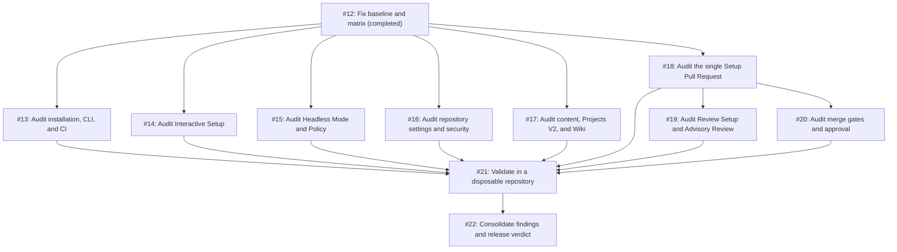

# Baseline and Contracts Traceability Matrix for gh-setup

**Status:** Fixed Baseline & Traceability Matrix (Ticket #12, Parent Issue #11)  
**Baseline Commit:** `3e3ed40c3d5a286fbc09bc079f05fc739ee3fe02`  
**Date:** 2026-10-10  

---

## 1. Fixed Baseline & Audit Environment

This document establishes the reproducible reference baseline for the production readiness audit of `gh-setup` (Issue #11, sub-issues #12 to #22). All subsequent tickets verify against this exact commit and baseline environment.

### 1.1 Environment Details

| Component | Baseline Specification | Observed Runtime |
| --- | --- | --- |
| **Git Commit** | `3e3ed40c3d5a286fbc09bc079f05fc739ee3fe02` | `3e3ed40c3d5a286fbc09bc079f05fc739ee3fe02` (origin/main) |
| **Operating System** | Linux x86_64 (Ubuntu 24.04 LTS) | Linux luiz 7.0.0-1014-azure #14~24.04.1-Ubuntu SMP PREEMPT x86_64 |
| **Python Runtime** | Python 3.10 or later (standard library) | Python 3.12.3 (`/usr/bin/python3`) |
| **CI Python Target** | Declared: Python 3.10+ | CI workflow executes only Python 3.10 |
| **GitHub CLI** | `gh` version 2.102.0 or compatible | `gh version 2.102.0` (2026-09-30) |
| **Test Framework** | Python standard library `unittest` | Python 3.12 `unittest` test runner |

### 1.2 Baseline Test Execution

- **Command:** `python3 -m unittest discover -s tests -p 'test_*.py' -v`
- **Working Directory:** `/home/agent/github-repo-setup`
- **Exit status:** 0
- **Observed Result:** 374 unit and integration tests passed in 4.341s (0 failures, 0 errors).

---

## 2. Representative Public Workflow

The representative public workflows were executed on the baseline version to verify CLI entry points and public interfaces without external side effects.

### 2.1 Help & Entry Point Commands

#### Command: `./gh-setup --help`
- **Exit status: 0**
- **Output:**
  ```text
  usage: gh-setup [-h] <command> ...

  Interactive and policy-driven GitHub repository configuration tool.

  options:
    -h, --help  show this help message and exit

  available commands:
    <command>
      apply     Apply a policy file in headless mode
  ```

#### Command: `./gh-setup apply --help`
- **Exit status: 0**
- **Output:**
  ```text
  usage: gh-setup apply [-h] --policy PATH [--repo OWNER/REPO]

  Apply repository configuration declared in a policy file without interactive
  prompts.

  options:
    -h, --help         show this help message and exit
    --policy PATH      Path to the policy JSON document to apply
    --repo OWNER/REPO  Target GitHub repository in OWNER/REPO format
  ```

#### Command: `./gh-setup apply --policy examples/setup-policy.json` (no token)
- **Exit status: 1**
- **Output:**
  ```text
  Error: GITHUB_TOKEN environment variable is required
  ```
- **Observed:** Correctly halts before any file parsing or API calls when `GITHUB_TOKEN` is unset.

#### Command: `python3 scripts/setup_github_repo.py --help`
- **Exit status: 0**
- **Output:**
  ```text
  usage: setup_github_repo.py [-h] --repo REPO [--token-env TOKEN_ENV]
                              {inventory,policy} ...

  Inventory and apply an explicit, versioned GitHub repository setup policy.

  positional arguments:
    {inventory,policy}
      inventory           read-only repository setup inventory
      policy              inspect or apply an explicit setup policy
  ```

---

## 3. Capability & Contracts Traceability Matrix

This matrix maps each subsystem and capability to its advertised contracts, current test/implementation evidence, identified gaps, and production risk levels.

| Subsystem / Capability | Advertised Contract | Current Evidence | Identified Gap | Risk Level |
| --- | --- | --- | --- | --- |
| **Installation & CLI** (`install.sh`, `gh-setup`) | Single-command installation (`install.sh`), symlink in `~/.local/bin/gh-setup`, clean help, strict exit codes (0: success/clean, 1: error, 2: blocked/unverified). | `test_installer.py`, `test_cli.py`, `test_integrated_docs.py` | `install.sh` suggests appending to `PATH` rather than prepending; CI runs single Python version. | Medium |
| **Interactive Setup** (`scripts/interactive*.py`) | Guided repository setup, Inventory query, Resume State detection, stage explanations, Policy v2 auto-save to `.local/setup-policy.json`, Dry-Run display, confirmation gate. | `test_state_detection.py`, `test_interactive_init.py`, `test_interactive_explanations.py`, `test_interactive_dryrun_apply.py` | Full multi-stage interactive session with mock terminal input requires complete end-to-end audit for all branch paths. | Medium |
| **Headless Mode & Policy Contracts** (`scripts/headless.py`) | Headless execution via Policy JSON; backward compatibility for Policy v1; strict schema validation for Policy v2; pre-write atomic validation; zero writes in Dry-Run or convergence. | `test_headless_apply.py`, `test_policy_v2_headless.py`, `test_policy_assembly.py` | Edge-case injection of mid-apply failures and recovery guidance needs systematic verification across all policy stages. | High |
| **Repository Settings** (`scripts/configure_github_repo.py`) | Toggle repository features (`issues`, `wiki`, `projects`), merge types, and branch deletion; idempotent writes. | `test_configure_github_repo.py`, `test_setup_github_repo.py` | Permission failure messages must distinguish org policy restrictions from missing personal token scopes. | Medium |
| **Security & CodeQL** | Enable vulnerability alerts, secret scanning; request CodeQL default setup; classify CodeQL `pending` as asynchronous rather than complete. | `test_setup_github_repo.py`, `test_e2e_audit.py` | Simulated tests verify `pending` status, but clear user guidance when CodeQL is disabled or unconfigured needs audit. | Medium |
| **Managed Content, Projects V2 & Wiki** | Managed labels, managed link comments, authored file sync with blob SHA CAS; Projects V2 GraphQL setup; Wiki Git publishing. | `test_setup_repository_content.py`, `test_setup_github_projects.py`, `test_publish_github_wiki.py` | Authored file CAS drift handling requires explicit SHA acknowledgement; unselected files must remain untouched. | Medium |
| **Setup Pull Request Workflow Staging** | Stage CI, dependency review, and Advisory Review together in ONE draft Setup Pull Request on `codex/workflows-*`; reuse identical open PR; reject drift/conflicts. | `test_install_github_workflows.py`, `test_e2e_audit.py` | Handling of head commit changes on the default branch while staging PR is open must be comprehensively tested. | High |
| **Review Setup & Advisory Review** | Optional Advisory Review in Policy v2; BYOK credentials in GitHub; `pull_request_target` on trusted base; fork skip; runtime diagnostics without secret leakage; `pending_configuration` status. | `test_review_setup.py`, `test_prompts.py`, `test_integrated_docs.py` | Live execution of review workflow in GitHub Actions requires disposable repository test with real LLM provider credentials. | High |
| **Merge Gates & Approval Evidence** | Activate branch ruleset requiring independent approval on current head and successful installed workflow check; defer gate when CI is only staged. | `test_configure_github_repo.py`, `test_e2e_audit.py` | Verify stale approvals, non-matching commit heads, and duplicate check names are cleanly rejected. | High |
| **CI & Automated Testing** | Automated testing across all announced Python versions (3.10, 3.11, 3.12); blocking linting step. | `.github/workflows/python-app.yml` | CI only tests Python 3.10; flake8 has `--exit-zero` making lint warnings non-blocking. | Medium |

---

## 4. Distinction of Commitments, Limitations, and Historical Items

To ensure the audit maintains clear boundaries and does not treat deliberate architectural decisions or historical artifacts as defects, the contracts are categorized into three distinct tiers:

### 4.1 Version Commitments (Enforced Contracts)
These are firm guarantees that the product promises and tests must enforce:
1. **Single Entry Point:** `gh-setup` is the sole public command for interactive setup and policy application.
2. **Zero Writes Safeguards:** Dry-Run mode and user rejection at interactive confirmation perform strictly zero API writes.
3. **Policy Compatibility:** Policy version 1 documents continue to parse and execute identically without regression.
4. **Policy Version 2 Generation:** Interactive Setup generates valid Policy version 2 documents auto-saved to `.local/setup-policy.json`.
5. **Unified Workflow Staging:** All selected workflows (CI, dependency review, Advisory Review) are staged in a single draft Setup Pull Request on branch `codex/workflows-*` and never written directly to the default branch.
6. **No Secret Ingestion or Leakage:** Provider keys and GitHub tokens are never stored in policies, persisted to disk, printed in terminal logs, or emitted in GitHub Actions workflow outputs.
7. **Idempotence & Convergence:** Re-applying a matching Policy against already-configured state produces zero writes (`"changes": []`).

### 4.2 Declared Limitations (Known Boundaries)
These are documented architectural choices and explicit product boundaries that are not bugs:
1. **Advisory Review Target Scope:** Initial release supports private repositories only; public repository support is deliberately tracked separately in [Issue #2](https://github.com/lispz1610/github-repo-setup/issues/2).
2. **Wiki Initialization:** The GitHub REST/GraphQL API cannot initialize the first Wiki page or set edit restrictions; the user must create the first page on GitHub before Wiki publishing can sync pages.
3. **Projects V2 Scope:** Projects V2 requires explicit caller-supplied owner and node IDs; the tool does not automatically infer project membership.
4. **CodeQL Asynchronous Acceptance:** A `pending` CodeQL default setup response indicates GitHub accepted the request; completion is asynchronous and requires GitHub UI inspection.
5. **No Automated Rollback:** When an apply operation fails mid-execution, already-applied changes are preserved; no automated rollback is attempted. Rerunning resumes and skips converged steps.
6. **Owner Merge Requirement:** Setup Pull Requests are created as draft PRs and are never auto-merged by `gh-setup`; merge authority remains strictly with the repository owner.

### 4.3 Historical Items (Reference Only)
These items represent historical implementations preserved for auditability and context:
1. **Standalone CLI `open-code-review-setup`:** Superseded and unified into `gh-setup`. References in older documentation are historical.
2. **Legacy Workflow Ownership Marker:** `# open-code-review-setup workflow-template=open-code-review version=1` is supported for migration when `expected_sha` is provided, but new staging generates unified markers.
3. **Historical Spec & Task Docs:** `docs/open-code-review-handoff.md` and `docs/open-code-review-project/` are explicitly marked as historical reference material.

---

## 5. Reproducible Findings and Gaps

The following reproducible findings and gaps have been observed on the baseline and will be addressed or validated across the audit tickets (#13 to #22):

### Finding 1: CI Workflow Runs Only Python 3.10
- **Location:** `.github/workflows/python-app.yml` (line 25)
- **Observed:**
  ```yaml
  with:
    python-version: "3.10"
  ```
- **Contract:** README states: *"Python 3.10 or later."*
- **Impact:** Python 3.11 and Python 3.12 runtimes (such as the 3.12.3 host environment) are not tested in continuous integration.
- **Auditing Ticket:** #13

### Finding 2: Flake8 Lint Step Is Informative / Non-Blocking
- **Location:** `.github/workflows/python-app.yml` (line 36)
- **Observed:**
  ```bash
  flake8 . --count --exit-zero --max-complexity=10 --max-line-length=127 --statistics
  ```
- **Contract:** CI quality checks should signal regressions on relevant standards.
- **Impact:** `--exit-zero` causes lint failures to exit with status 0, preventing CI from flagging style or lint regressions.
- **Auditing Ticket:** #13

### Finding 3: README Examples Reference Direct Script for Policy Apply
- **Location:** `README.md` (lines 140, 148, 149)
- **Observed:**
  ```bash
  python3 scripts/setup_github_repo.py --repo OWNER/REPO policy --file .local/setup-policy.json
  ```
- **Contract:** Section 1 ("Quick start") and ADR 0001 establish `gh-setup apply --policy ...` as the primary unified interface.
- **Impact:** Users are directed to bypass `gh-setup` for policy applications in example snippets.
- **Auditing Ticket:** #13

### Finding 4: Installer PATH Suggestion Appends Rather Than Prepends
- **Location:** `install.sh` (line 32)
- **Observed:**
  ```bash
  echo "  export PATH=\"\$PATH:$BIN_DIR\""
  ```
- **Contract:** README line 50 specifies `export PATH="$HOME/.local/bin:$PATH"`.
- **Impact:** Appending `$BIN_DIR` to the end of `PATH` could allow older or system binaries to shadow the installed `gh-setup`.
- **Auditing Ticket:** #13

---

## 6. Audit Execution Roadmap

With the baseline fixed and the matrix established, the remaining audit tickets will proceed according to the dependency graph:


