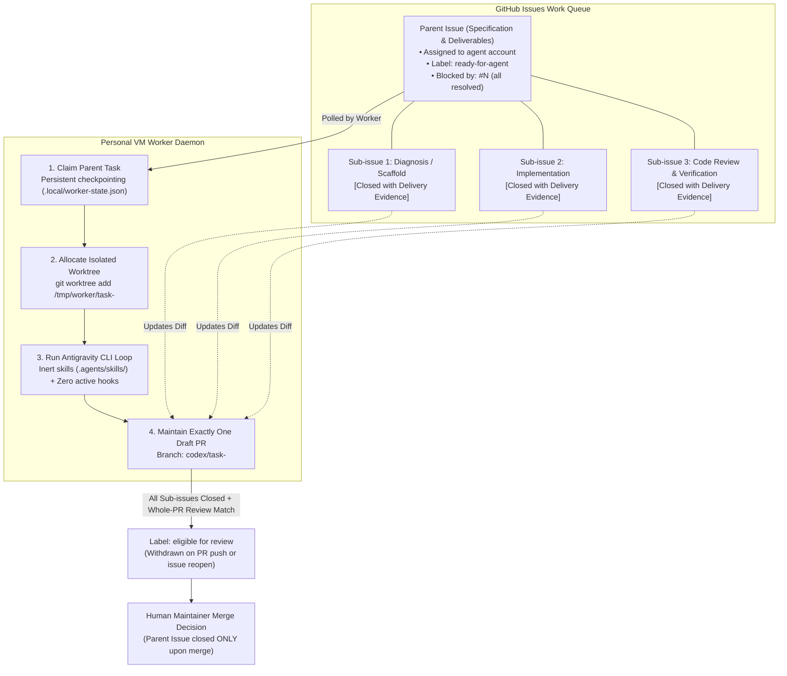
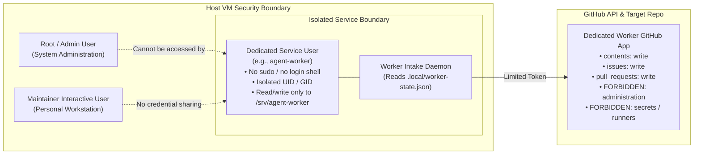

# Future Works & Roadmap: Post-P7 Horizons

This document is the canonical repository roadmap for initiatives sequenced after the core release milestones (P0 through P7). It establishes the formal specifications for **Horizon P8** (Product Conformance Audit & Traceability Matrix) and **Horizon P9** (Autonomous Issue Queue & Constrained VM Worker), consolidating and retiring open post-P7 tracking issues ([#167](https://github.com/lispz1610/sciflow-cicd/issues/167), [#168](https://github.com/lispz1610/sciflow-cicd/issues/168), [#169](https://github.com/lispz1610/sciflow-cicd/issues/169), [#170](https://github.com/lispz1610/sciflow-cicd/issues/170), and [#171](https://github.com/lispz1610/sciflow-cicd/issues/171)).

---

## 1. Executive Summary & Milestone Boundary

The `sciflow-cicd` product has finalized active development for its core v1.0 release baseline, successfully delivering capabilities across seven practice groups and eight milestone increments (P0–P7) governed by [ADR 0001](adr/0001-unify-repository-and-review-setup.md), [ADR 0002](adr/0002-one-setup-pull-request-for-selected-workflows.md), [ADR 0003](adr/0003-self-contained-release-candidate-verification.md), [ADR 0004](adr/0004-isolate-automated-report-identities.md), [ADR 0005](adr/0005-canonical-readme-and-wiki-fallback.md), and [ADR 0006](adr/0006-single-commit-cutover-for-clean-delivery.md):

- **P0 / P1:** Science-focused client core, inventory probing, mandatory dry-run drift check, unified setup, and single draft **Setup Pull Request** staging.
- **P2:** Scientific CI profiles (`python-scientific`, `cmake-mpi`), caching, matrix optimization, 40-character Action SHA pins, and unmatrixed **Stable Status Checks** (`status-check`, `smoke-test`).
- **P3:** Proportional security, capability detection (`sciflow-cicd doctor`), monthly grouped Dependabot updates, Dependency Review security gates, CodeQL Default Setup, and solo-maintainer branch rulesets (`0` approvals).
- **P4:** Citable software releases, `CITATION.cff` validation, 5-state DOI governance (`scripts/doi_guidance.py`), fail-closed SPDX 2.3 `sbom.spdx.json` export, and opt-in GHCR container publishing.
- **P5 / P5.6:** Vendored Matt Pocock agent skill catalog (27 skills at `49dd158d`), SHA-256 manifest provenance, conflict-free upgrades/removals, **Documentation Freshness Audit**, and **Opt-In Hook Contract** (`opt_in: false` default).
- **P6:** Canonical maintainer documentation in [`README.md`](../README.md), observable symptom recovery, and end-to-end integrated setup verification.
- **P7:** Automated Open Code Review (`sciflow-cicd ocr` CLI operating under systemd on a dedicated VM polling allowlisted repositories) for pull requests on private repositories with isolated findings reporting.
- **P10:** Project finalization, documentation decoupling from temporary sandboxes, canonical future works roadmap, and single-commit clean repository cutover ([Issue #217](https://github.com/lispz1610/sciflow-cicd/issues/217)).

With the core development cycle concluded, subsequent initiatives are organized into two distinct future horizons:

| Horizon | Primary Focus | Scope & Source Tracking Issues | Milestone Status |
| --- | --- | --- | --- |
| **Horizon P8** | **Product Conformance Audit & Traceability Matrix** | Comprehensive verification of delivered capabilities against specifications, boundary validation, adversarial stress testing, and doc-code drift detection. Consolidates [#168](https://github.com/lispz1610/sciflow-cicd/issues/168) and [#169](https://github.com/lispz1610/sciflow-cicd/issues/169). | **Planned / Future Roadmap** |
| **Horizon P9** | **Autonomous Issue Queue & Constrained VM Worker** | Autonomous Antigravity execution loop on a personal VM consuming tasks from GitHub Issues via native subissues, blockers, durable claiming, and draft PRs under a restricted Linux service user. Consolidates [#167](https://github.com/lispz1610/sciflow-cicd/issues/167), [#170](https://github.com/lispz1610/sciflow-cicd/issues/170), and [#171](https://github.com/lispz1610/sciflow-cicd/issues/171). | **Planned / Future Roadmap** |

---

## 2. Horizon P8: Product Conformance Audit & Traceability Matrix

Horizon P8 governs the post-delivery verification and auditing of the complete implementation against repository specifications, ADRs, and documentation. Its purpose is to gate any future autonomous execution upon a proven, hardened, and drift-free foundation.

### 2.1 Conformance Audit Matrix (P0 through P7)

The P8 audit enforces an exhaustive traceability matrix mapping every acceptance criterion from original specifications and sub-issues to implementing code modules, test suites, and documentation:

| Milestone & Practice Group | Functional Scope & Acceptance Deliverables | Implementing Code Modules & Workflows | Verification Suites & Test Harnesses | Documentation & Evidence Records |
| --- | --- | --- | --- | --- |
| **P0: Science-Focused Client Core** | Inventory inspection, declarative policy generation (`.local/setup-policy.json`), mandatory read-only dry-run (`.local/setup-dry-run.json`), drift-checked partial apply, owner-file protection. | `scripts/setup_github_repo.py`, `scripts/policy_assembly.py`, `scripts/headless.py` | `tests/test_setup_github_repo.py`, `tests/test_policy_assembly.py`, `tests/test_headless_apply.py` | [`docs/policy-reference.md`](policy-reference.md) |
| **P1: Unified Setup & Setup PR** | Single unified `install.sh`, interactive & headless setup CLI, single draft Setup PR (`codex/workflows-<repo>`), multi-stage file staging. | `install.sh`, `scripts/setup_github_repo.py`, `scripts/install_github_workflows.py` | `tests/test_install_github_workflows.py`, `tests/test_ticket_33_unified_workflows.py` | [ADR 0001](adr/0001-unify-repository-and-review-setup.md), [ADR 0002](adr/0002-one-setup-pull-request-for-selected-workflows.md) |
| **P2: Scientific CI Profiles** | Stack-specific CI profiles (`python-scientific`, `cmake-mpi`), matrix sizing, dependency/compiler caching (`pip`, `ccache`), Git LFS, unmatrixed **Stable Status Checks** (`status-check`, `smoke-test`). | `.github/workflows/ci.yml`, `scripts/install_github_workflows.py` | `tests/test_profile_ci_scaffolding.py`, `tests/test_cmake_mpi_profile.py` | [`docs/scientific-ci-profiles.md`](scientific-ci-profiles.md) |
| **P3: Proportional Security & Merge Controls** | Capability detection (four states: `[CONFIGURED]`, `[MISSING]`, `[UNSUPPORTED]`, `[INACCESSIBLE]` from `scripts/repository_capabilities.py`; `sciflow-cicd doctor` adds non-blocking `ADVISORY` runner findings), monthly grouped Dependabot, PR Dependency Review gate with license allowlists, CodeQL Default Setup, solo-maintainer rulesets (`0` approvals). | `scripts/repository_capabilities.py`, `scripts/configure_github_repo.py`, `scripts/dependabot_generator.py`, `.github/workflows/dependency-review.yml` | `tests/test_repository_capabilities.py`, `tests/test_dependency_review_workflow.py`, `tests/test_solo_maintainer_ruleset.py` | [`docs/proportional-security-and-controls.md`](proportional-security-and-controls.md), [`docs/dependency-graph-governance.md`](dependency-graph-governance.md) |
| **P4: Citable Releases & Supply Chain** | Six-stage Release Candidate lifecycle, explicit-tag promotion (`--tag v<target_version>`), `CITATION.cff` validation, 5-state DOI governance (`scripts/doi_guidance.py`), fail-closed SPDX 2.3 `sbom.spdx.json` export, opt-in GHCR container publishing. | `scripts/verify_release.py`, `scripts/release_promotion.py`, `scripts/doi_guidance.py`, `scripts/export_release_sbom.py`, `.github/workflows/release-promotion.yml`, `scripts/install_github_workflows.py` (container-publish template) | `tests/test_verify_release.py`, `tests/test_release_promotion.py`, `tests/test_release_sbom.py`, `tests/test_container_publish_workflow.py` | [`docs/release-evidence.md`](release-evidence.md), [`docs/doi-guidance.md`](doi-guidance.md), [ADR 0003](adr/0003-self-contained-release-candidate-verification.md) |
| **P5: Agent Skills & Opt-In Hooks** | 27 vendored Matt Pocock skills under `.agents/skills/` at `49dd158d`, SHA-256 manifest provenance, conflict-free upgrades, explicit removal gate (`allow_removed_skills`), runtime discovery verification, **Documentation Freshness Audit**, **Opt-In Hook Contract** (`opt_in: false`). | `scripts/provision_agent_skills.py`, `scripts/agent_skill_upgrade.py`, `scripts/agent_skills_readiness.py`, `scripts/verify_agent_skill_discovery.py`, `scripts/documentation_freshness.py`, `scripts/hook_contracts.py`, `.github/workflows/documentation-freshness.yml` | `tests/test_provision_agent_skills.py`, `tests/test_agent_skills_readiness.py`, `tests/test_hook_contracts.py` | [`docs/agent-skills.md`](agent-skills.md), [`docs/documentation-freshness.md`](documentation-freshness.md), [ADR 0004](adr/0004-isolate-automated-report-identities.md) |
| **P6: Canonical Maintainer Documentation** | Canonical maintainer documentation in [`README.md`](../README.md), symptom-driven troubleshooting and recovery matrix, observable evidence rules, end-to-end maintainer journey. | `README.md`, `GLOSSARY.md`, `AGENTS.md`, `docs/agents/*`, `scripts/check_markdown_links.py`, `scripts/audit_module_dependencies.py` | `tests/test_p6_*.py`, `tests/test_p6_188_integrated_setup_proof.py` | [`README.md`](../README.md), [ADR 0005](adr/0005-canonical-readme-and-wiki-fallback.md) |
| **P7: Automated Open Code Review** | Automated OCR CLI pipeline (`sciflow-cicd ocr`) operating under systemd on a dedicated VM, RS256 JWT App signing, loopback HTTP mock server, fork-skipping, token budget limits, allowlisted repository polling with isolated findings reporting. | `scripts/ocr_runner.py`, `scripts/ocr_reviewer.py`, `scripts/ocr_preflight.py`, `scripts/ocr_safety.py` | `tests/test_ocr_pipeline_e2e.py`, `tests/test_ocr_preflight.py`, `tests/test_advisory_review_audit.py` | [`docs/advisory-review.md`](advisory-review.md), [ADR 0004](adr/0004-isolate-automated-report-identities.md) |

### 2.2 Boundary Checks & Hardware Honesty

The P8 audit enforces strict evidence rules ([`#evidence-and-documentation-boundary`](maintainer-reference.md#evidence-and-documentation-boundary)):

1. **Host Smoke Checks vs. Real Accelerator Hardware:**
   - Automated GitHub Actions jobs (`status-check`, `smoke-test`) run on standard GitHub-hosted `ubuntu-24.04` runners (2–4 vCPUs, shared memory).
   - Smoke checks prove compilation, unit tests, and CPU OpenMP/MPI rank initialization.
   - They **never claim GPU execution, multi-node scaling, or production numerical accuracy**. Real GPU execution requires maintainers to record external execution via Google Colab or dedicated HPC clusters with platform identity (`nvidia-smi`), rank counts, and reference tolerances ([`docs/scientific-ci-profiles.md`](scientific-ci-profiles.md)).
2. **Offline Loopback vs. External Services:**
   - Test suites in `tests/` (such as `tests/test_ocr_pipeline_e2e.py`) execute locally using offline loopback servers, OpenSSL key generation, and synthetic JSON fixtures.
   - Tests verify CLI parsing, cryptographic signing, and state transitions without live external network calls to GitHub.com, Zenodo, or LLM providers.
   - Live external provider calls are marked as separate operational demonstrations.

### 2.3 Doc-Code Drift Detection & Adversarial Stress Testing

The P8 roadmap specifies automated and manual procedures to identify drift between code implementation and user-facing documentation:

- **CLI Interface Drift:** Verifying that CLI help outputs, options, and error messages for `sciflow-cicd`, `sciflow-cicd doctor`, `sciflow-cicd dry-run`, `sciflow-cicd apply`, and `sciflow-cicd ocr` match the code examples in [`README.md`](../README.md) and [`docs/`](maintainer-reference.md#complete-repository-documentation-index) verbatim.
- **Workflow & Permission Drift:** Ensuring that permissions declared in `.github/workflows/*.yml` match the least-privilege matrix in documentation and that all third-party Actions remain pinned to immutable 40-character commit SHAs.
- **Adversarial Fault Testing:** Probing failure modes including network timeouts, revoked tokens, missing OAuth scopes, malformed JSON/YAML policies, and rate limits, confirming that error messages provide clear, actionable recovery commands.
- **Hygiene & Finding Classification:** Categorizing all audit findings into bugs, points of attention, and enhancements using repository triage labels (`needs-triage`, `needs-info`, `ready-for-agent`, `ready-for-human`, `wontfix`).

### 2.4 Ergonomics, Recovery & CLI Tooling Enhancements

Based on live repository usage and operational readiness validation, the following tooling improvements are prioritized under Horizon P8:

1. **Automated Rollback Command (`sciflow-cicd rollback`):**
   - **Context & Motivation:** While workflows, templates, and agent skills are staged non-destructively in a single draft Setup Pull Request (`codex/workflows-<hash>`), direct repository settings (`merge`, `features`, `actions-policy`, `rulesets`) mutate immediately upon `apply`. Reverting unexpected direct settings currently requires manual UI changes or authoring an inverse Policy JSON.
   - **Specification:** Implement a first-class `sciflow-cicd rollback --plan <applied-dry-run.json>` command that consumes the pre-apply inventory snapshot from the accepted Dry-Run result, synthesizes a reverse patch policy, verifies Compare-and-Swap (CAS) preflight state, and restores original settings with explicit confirmation and structured audit output.

2. **CLI Output Consistency (`sciflow-cicd doctor --json`):**
   - **Context & Motivation:** Executing `sciflow-cicd doctor --json` without `--repo OWNER/REPO` currently ignores `--json` and prints human-readable plaintext diagnostics for the local runtime; structured JSON is emitted only when `--repo` is provided.
   - **Specification:** Normalize CLI flag handling so `sciflow-cicd doctor --json` always emits valid structured JSON diagnostics (Python version, Git installation, GitHub CLI auth status, `GITHUB_TOKEN` presence, and `PATH` precedence) with standard severity fields (`passed`, `is_fatal`, `message`).

3. **Python Profile Manifest Detection & `cache: "pip"` Auto-Guard:**
   - **Context & Motivation:** The `profile-ci` Python profile previously defaulted to `cache: true` (`cache: "pip"` under `actions/setup-python`), which failed CI when a repository uses only the Python standard library or lacks a root `requirements.txt` or `pyproject.toml`.
   - **Specification:** Automatically probe the target repository for `requirements.txt` or `pyproject.toml` during `run_policy` / `render_ci_profile` and default `cache` to `false` (with a clear advisory notice) when no dependency manifest exists, or allow seamless opt-in manifest scaffolding.

4. **Root Governance Files (`CITATION.cff`, `.gitattributes`) & First-Class Review Fallback Schema:**
   - **Context & Motivation:** Currently, `scripts/setup_repository_content.py` restricts the `files` stage to Issue forms, PR templates, and `docs/*.md`, requiring root files like `CITATION.cff` or `.gitattributes` to be committed manually. Similarly, `scripts/review_policy.py` should expose explicit policy fields for fallback model and fallback token budgets (`fallback_model`, `fallback_max_tokens_budget`, `fallback_reasoning_effort`).
   - **Specification:** Allow explicit allowlisted root governance files (`CITATION.cff`, `.gitattributes`) in the `files` stage with compare-and-swap SHA guards, and expand `review_policy.py` schema validation for native two-pass fallback configuration.

5. **Documentation Freshness Noise Control on Automated Dependency PRs:**
   - **Context & Motivation:** Enabling `.github/dependabot.yml` triggers an initial burst of up to `open_pull_requests_limit` (`5`) workflow-bump PRs, each of which triggers `documentation-freshness` to open a `needs-triage` tracking issue even when no documentation behavior changed.
   - **Specification:** Refine `documentation-freshness` change classification so pure SHA/version pin bumps on `dependabot[bot]` PRs emit clean audit statuses without creating redundant tracking issues.

---

## 3. Horizon P9: Autonomous Issue Queue & Constrained VM Worker

Horizon P9 specifies the architecture for an autonomous implementation worker running Antigravity on a personal VM. The worker consumes tasks directly from GitHub Issues, maintains a single draft PR per task, and operates under strict security boundaries.

### 3.1 Native Issue Queue Intake Contract (Issue #170)

The intake contract uses native GitHub Issues without requiring external orchestrator databases or heavy board configurations:

#### Intake & Dispatching Rules:
1. **Parent-Child Decomposition:** Every implementable task must have a parent issue defining the complete specification and acceptance criteria, decomposed into one or more native sub-issues. Bug-fix tasks must follow a diagnosis-first structure (diagnosis sub-issue, followed by implementation and review sub-issues).
2. **Eligibility Preconditions:** A parent issue is dispatchable if and only if:
   - It contains a substantive specification and at least one child sub-issue.
   - All upstream dependencies (`Blocked by #N`) are closed (evaluated via `issue-frontier-orchestrator.yml`).
   - It is explicitly assigned to the dedicated agent GitHub user.
   - It bears the canonical `ready-for-agent` label.
3. **Single Draft PR Lifecycle:**
   - The worker maintains **exactly one draft Pull Request** per parent issue.
   - Individual sub-issues push progressive commits to the shared PR branch (`codex/task-<parent-id>`).
   - Completed sub-issues are closed with verified `## Delivery` comments while the parent issue remains open.
4. **Review-Eligibility State Gate:**
   - When all child sub-issues are closed, the worker verifies that a whole-PR review passes and matches the current PR HEAD SHA.
   - Upon successful verification, the worker adds the `eligible for review` label to the draft PR.
   - If a new commit is pushed or a sub-issue is reopened, the label is immediately withdrawn.
   - **Human Merge Gate:** The parent issue is never closed by the worker; it is closed only when the human maintainer approves and merges the PR.

### 3.2 Task Reservation, Checkpointing, and Workspace Isolation

To prevent race conditions, repeated comment spam, or duplicate PRs:

- **Durable Task Claiming:** The worker claims exactly one eligible parent issue at a time, persisting its claim in local checkpoint storage (`.local/worker-state.json`).
- **Restart Resilience:** If the worker process restarts or loses network access, it reads the checkpoint file, resumes the active task at the last verified sub-issue boundary, and reconciles state with GitHub before taking further action.
- **Isolated Workspaces:** Each claimed task executes in a dedicated git worktree or container sandbox (`/tmp/worker/task-<parent-id>`), preventing cross-task contamination, cache poisoning, or residue from lingering background processes.

### 3.3 Antigravity Autonomous Execution Pipeline

Within the isolated task workspace, the worker drives the Antigravity execution pipeline:

- **Agent Invocations:** The worker launches Antigravity against the target sub-issue, passing the specific requirements and acceptance criteria.
- **Skill Discovery & Inert Data:** Antigravity reads vendored skills from `.agents/skills/`. Skills remain inert instruction files; lifecycle hooks remain disabled by default under the **Opt-In Hook Contract** (`scripts/hook_contracts.py`).
- **Evidence Verification:** Before requesting sub-issue closure, the worker runs the repository test suite (`python3 -m unittest discover tests`), markdown link audits (`scripts/check_markdown_links.py`), and architectural dependency checks (`scripts/audit_module_dependencies.py`).
- **Progressive Delivery Proof:** The sub-issue is closed only when the commit is pushed and verified delivery evidence is posted to the issue thread.

### 3.4 Security Boundaries & Linux Service User Model (Issue #171)

The VM worker operates under a strict principle of least privilege:

#### Security Invariants:
1. **Dedicated Linux Service User:** The worker runs under an isolated, unprivileged OS user (`agent-worker`) with a dedicated home directory (`/srv/agent-worker`), restricted file permissions (`chmod 700`), and no sudo or interactive login privileges.
2. **Restricted GitHub App Identity:**
   - Authentication uses a dedicated GitHub App installation token.
   - Permissions are strictly confined to: `contents: write` (push branches), `issues: write` (comment and label), and `pull_requests: write` (open draft PRs).
   - **Explicitly Forbidden:** `administration` (cannot modify repo settings or rulesets), `secrets` (cannot read or write CI credentials), and `organization` administration.
3. **Identity & Credential Preflight:**
   - The daemon executes preflight validation on startup.
   - It strictly rejects client/administrative PATs or App tokens with excessive scopes.
   - It verifies that the assigned GitHub user account matches the expected agent identity.
   - Preflight reports effective permissions without exposing private keys or tokens in logs.
4. **Runner Demarcation:**
   - **The personal VM is NOT a GitHub self-hosted Actions runner.**
   - The worker daemon communicates strictly as an external client via GitHub's REST/GraphQL APIs and Git/HTTPS.
   - It never registers with GitHub Actions runner pools, protecting the persistent VM from executing untrusted workflow payloads.

---

## 4. Post-P7 Tracking Issue Reconciliation

With the formalization of this document, open tracking issues for post-P7 initiatives are reconciled into this canonical roadmap:

| Issue # | Original Title | Horizon | Consolidated Section in this Roadmap | Reconciliation Disposition |
| --- | --- | --- | --- | --- |
| **[#167](https://github.com/lispz1610/sciflow-cicd/issues/167)** | P9: Issue queue and constrained VM worker for automated implementation (future feature) | **P9** | [Section 3: Horizon P9 Autonomous Issue Queue & Constrained VM Worker](#3-horizon-p9-autonomous-issue-queue-constrained-vm-worker) | Consolidated into Horizon P9; cross-referenced and closed for core release milestone. |
| **[#168](https://github.com/lispz1610/sciflow-cicd/issues/168)** | P8: Validate, audit, and reconcile full product implementation from P0 to P7 against specs | **P8** | [Section 2: Horizon P8 Product Conformance Audit & Traceability Matrix](#2-horizon-p8-product-conformance-audit-traceability-matrix) | Consolidated into Horizon P8; cross-referenced and closed for core release milestone. |
| **[#169](https://github.com/lispz1610/sciflow-cicd/issues/169)** | P8: Audit and close out P0-P7 against documented specs | **P8** | [Section 2.1: Conformance Audit Matrix (P0 through P7)](#21-conformance-audit-matrix-p0-through-p7) | Consolidated into Horizon P8; cross-referenced and closed for core release milestone. |
| **[#170](https://github.com/lispz1610/sciflow-cicd/issues/170)** | P9.0: Define the Issue queue and review-eligibility contract | **P9** | [Section 3.1: Native Issue Queue Intake Contract](#31-native-issue-queue-intake-contract-issue-170) | Consolidated into Horizon P9; cross-referenced and closed for core release milestone. |
| **[#171](https://github.com/lispz1610/sciflow-cicd/issues/171)** | P9.1: VM installation and identity preflight | **P9** | [Section 3.4: Security Boundaries & Linux Service User Model](#34-security-boundaries-linux-service-user-model-issue-171) | Consolidated into Horizon P9; cross-referenced and closed for core release milestone. |

---

## 5. Architectural References

- **[ADR 0001: Unify repository and Review Setup into `sciflow-cicd` and Policy v2](adr/0001-unify-repository-and-review-setup.md)**
- **[ADR 0002: One Setup Pull Request for selected workflows](adr/0002-one-setup-pull-request-for-selected-workflows.md)**
- **[ADR 0003: Self-contained release candidate verification](adr/0003-self-contained-release-candidate-verification.md)**
- **[ADR 0004: Isolate automated report identities](adr/0004-isolate-automated-report-identities.md)**
- **[ADR 0005: Canonical `README.md` and Wiki fallback](adr/0005-canonical-readme-and-wiki-fallback.md)**
- **[ADR 0006: Single-commit cutover for clean product delivery](adr/0006-single-commit-cutover-for-clean-delivery.md)**
- **[Issue #217](https://github.com/lispz1610/sciflow-cicd/issues/217)**
