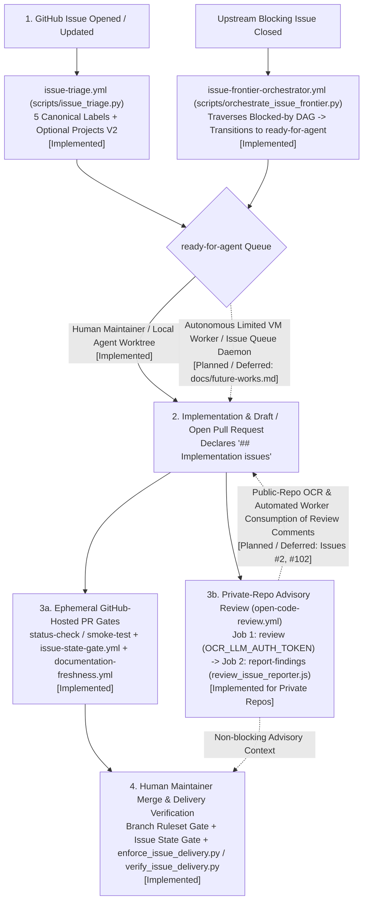
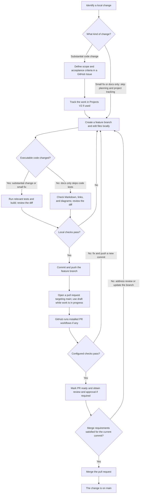

# GitHub repository setup

`sciflow-cicd` is the canonical client for configuring, auditing, and governing scientific and software GitHub repositories. It provides a guided **Interactive Setup** that inspects repository **Inventory**, detects **Resume State**, guides modular stage configuration across seven practice groups, automatically persists a **Policy**, computes a read-only **Dry-Run**, and applies changes only after explicit confirmation (`Apply these changes? [y/N]: `). **Headless Mode** uses the same Policy and Dry-Run core for non-interactive validation and fleet convergence. Direct Python scripts remain available for individual resources and operator workflows.

Canonical domain vocabulary is defined in [`GLOSSARY.md`](../GLOSSARY.md), agent skill and workflow routing is indexed in [`AGENTS.md`](../AGENTS.md), and durable architectural decisions are recorded in [`docs/agents/domain.md`](agents/domain.md) and [`docs/adr/`](adr/0005-canonical-readme-and-wiki-fallback.md). Evolving specifications, feature requests, bug reports, and implementation tickets live in **GitHub Issues** ([`docs/agents/issue-tracker.md`](agents/issue-tracker.md)) rather than a competing specification tree. Post-P7 architectural initiatives (P8 conformance audit and P9 autonomous VM worker) are canonically specified in the [Future Works roadmap](future-works.md).

Automated verification suites and live governance are maintained across unit, integration, and CI profiles:
- Core client setup, Dry-Run, apply, and owner-reviewed file staging (`tests/test_science_client_exercise.py`).
- Scientific CI profiles (`python-scientific` and `cmake-mpi` smoke checks, caching, and Stable Status Check reporting in [`docs/scientific-ci-profiles.md`](scientific-ci-profiles.md)).
- Proportional security, solo-maintainer rulesets, and merge controls in [`docs/proportional-security-and-controls.md`](proportional-security-and-controls.md).
- Automated Advisory Review, loopback/OpenSSL verification, and external provider boundaries in [`docs/advisory-review.md`](advisory-review.md).

### Maintainer Navigation Outline

1. [Requirements](#requirements)
2. [Supported profiles and practice decision matrix](#supported-profiles-and-practice-decision-matrix)
3. [Architecture and trust boundaries](#architecture-and-trust-boundaries)
4. [Client setup](#client-setup)
5. [GitHub manual steps](#github-manual-steps)
6. [Operation](#operation)
7. [Troubleshooting and recovery by symptom](#troubleshooting-and-recovery-by-symptom)
8. [Evidence and documentation boundary](#evidence-and-documentation-boundary)

---

## Requirements

### Runtime and Credential Prerequisites

- **Python 3.10 or later.** Runtime commands use the Python standard library; `PyYAML` is optional for YAML syntax verification tests.
- **Git and GitHub CLI (`gh`).** Required by `install.sh` and used by `sciflow-cicd doctor` as an authentication fallback when `GITHUB_TOKEN` is not exported.
- **A least-privilege GitHub token in `GITHUB_TOKEN`.** Grant only the scopes needed for the selected commands:
  - Classic PAT: `repo`, `workflow` (required to stage `.github/workflows/*.yml` in a **Setup Pull Request**), and `read:org` (plus `project` when managing Projects V2).
  - Fine-grained PAT: **Metadata** (read), **Administration** (read/write for repository settings, security toggles, and rulesets), **Contents** (read/write), **Workflows** (read/write), **Pull requests** (read/write), and **Issues** (read/write).
- **Dedicated limited OCR GitHub App (for optional `sciflow-cicd ocr` CLI pipeline only).** Configured with `contents: read`, `pull_requests: write`, and `metadata: read` (`administration` forbidden, separate from any administrative/`sciflow-cicd` client App), an RSA PEM private key (`chmod 600`), the `openssl` CLI for RS256 App JWT signing, an `ocr` executable (`--ocr-bin` or `OCR_CLI_BIN`), and local `OCR_LLM_*` provider environment variables (`OCR_LLM_AUTH_TOKEN`, `OCR_LLM_URL`, `OCR_LLM_MODEL`, `OCR_LLM_USE_ANTHROPIC`).
- **Network access to GitHub.com.** Repository, security, and workflow commands use GitHub's REST API; [Projects V2](projects-v2.md) uses GraphQL; [Wiki publishing](agents/wiki.md) uses Git/HTTPS or SSH access to the separate `<OWNER>/<REPO>.wiki.git` repository.

Keep tokens and provider keys out of policy files, shell arguments, logs, and Git history. `sciflow-cicd` never creates credentials or elevates permissions on your behalf.

The scheduled [policy drift audit](policy-drift-audit.md) uses a separate `POLICY_AUDIT_TOKEN` repository secret because GitHub requires repository-administration read access to inspect every setting in a checked-in policy. Its workflow defaults to `contents: read`; only its isolated issue-reporting job receives `issues: write`. See the [continuous automation guide](agents/automation.md) for operator references covering Wiki sync, issue triage, release promotion, Markdown links, and Action pin audits.

### Product Functional Requirements (`FR-1` – `FR-7`)

Each functional requirement maps one of the seven practice groups ([practice decision matrix](#supported-profiles-and-practice-decision-matrix)) to a supported `sciflow-cicd` behavior or an explicit manual GitHub UI step ([`#github-manual-steps`](#github-manual-steps)):

| Requirement ID | Practice Group | Functional Requirement Contract | Automated Behavior vs Manual Boundary |
| --- | --- | --- | --- |
| **`FR-1`** | **1. Client Setup, Inventory, Dry-Run, & Setup Pull Request (P0 / P1)** | Inspect live repository **Inventory** and **Resume State**, persist a declarative **Policy** (`.local/setup-policy.json`), compute a read-only **Dry-Run** (`.local/setup-dry-run.json`), enforce drift-checked apply, and stage all repository file changes in a single draft **Setup Pull Request** (`codex/workflows-<repo>`). | **Automated:** `sciflow-cicd`, `sciflow-cicd dry-run`, `sciflow-cicd apply`, `scripts/setup_github_repo.py`, `scripts/install_github_workflows.py`.<br>**Manual:** Human review and **owner merge** of the draft **Setup Pull Request** ([`#github-manual-steps`](#github-manual-steps) Step 1). |
| **`FR-2`** | **2. Scientific CI Profiles & Hardware Honesty (P2)** | Stage stack-specific **Scientific CI Profiles** (`python-scientific`, `cmake-mpi` / `cpp-hpc-mpi`) or standard `ci` with configurable matrices, dependency/compiler caching (`pip`, `ccache`), optional Git LFS (`git_lfs`), and unmatrixed **Stable Status Check** anchors (`status-check`, `smoke-test`, `test`) that separate fast CPU pull-request smoke checks from external GPU/HPC validation. | **Automated:** `workflows` stage in `scripts/install_github_workflows.py` (`.github/workflows/ci.yml`).<br>**Manual:** Running real GPU or multi-node HPC benchmarks on Google Colab or cluster hardware ([`docs/scientific-ci-profiles.md`](scientific-ci-profiles.md)). |
| **`FR-3`** | **3. Proportional Security, Solo-Maintainer Merge Gates, & Supply-Chain Governance (P3)** | Probe repository capabilities (`[CONFIGURED]`, `[MISSING]`, `[UNSUPPORTED]`, `[INACCESSIBLE]`), enforce read-only default workflow tokens (`default_workflow_permissions: read`), 40-char Action commit SHA pins, restrained monthly grouped Dependabot updates, capability-gated CodeQL Default Setup and Dependency Review, and branch rulesets supporting both solo maintainers (`reviewer: "none"`, `required_approving_review_count: 0`) and collaborative teams (`>= 1` approval). | **Automated:** `sciflow-cicd doctor`, `scripts/configure_github_repo.py` (`actions`, `security`, `codeql`, `gates`), `scripts/dependabot_generator.py`, `.github/workflows/dependency-review.yml`.<br>**Manual:** Two-pass ruleset activation after merging the Setup PR and inspecting plan-gated UI toggles ([`#github-manual-steps`](#github-manual-steps) Steps 2 & 5). |
| **`FR-4`** | **4. Explicit-Tag Releases, Citation (`CITATION.cff`), DOI Governance, SBOM, & Containers (P4)** | Qualify **Release Candidates** via a fail-closed **Release Gate** (`scripts/verify_release.py`) and promote releases exclusively from explicit immutable tags (`--tag v<target_version>`) across `minimal`, `release`, and `scientific` profiles with `CITATION.cff` validation, 5-state DOI governance (`unselected`, `requested`, `pending`, `issued`, `unavailable`), fail-closed SPDX 2.3 `sbom.spdx.json` export, and opt-in `container-publish` (`ghcr.io`). | **Automated:** `scripts/verify_release.py`, `scripts/release_promotion.py`, `scripts/doi_guidance.py`, `scripts/export_release_sbom.py`, `.github/workflows/release-promotion.yml`, `.github/workflows/container-publish.yml`.<br>**Manual:** Connecting the Zenodo GitHub webhook or uploading a private manual archive deposit before recording `doi_state: "issued"` ([`#github-manual-steps`](#github-manual-steps) Step 6). |
| **`FR-5`** | **5. Vendored Agent Skills, Documentation Freshness, & Opt-In Hook Contracts (P5 / P5.6)** | Stage the source-pinned Matt Pocock skill catalog (`27` skills at `49dd158d1076134a641b33efb035946536778336`, `v1.3.1`, MIT) as inert repository data under `.agents/skills/` with SHA-256 manifest provenance, local-edit conflict preservation, explicit removal acknowledgment (`allow_removed_skills`), readiness/compatibility reporting, runtime discovery verification, **Documentation Freshness Audit**, and an **Opt-In Hook Contract** disabled by default. | **Automated:** `agent-skills` stage (`scripts/provision_agent_skills.py`, `scripts/agent_skill_upgrade.py`, `scripts/verify_agent_skill_discovery.py`, `scripts/documentation_freshness.py`, `scripts/hook_contracts.py`).<br>**Manual:** Authoring project-specific domain docs (`GLOSSARY.md`, `docs/agents/*`) via `/setup-matt-pocock-skills` or resolving local skill file conflicts. |
| **`FR-6`** | **6. Issue Triage, DAG Frontier Orchestration, & Issue State Gate** | Maintain canonical 5-label issue triage (`needs-triage`, `needs-info`, `ready-for-agent`, `ready-for-human`, `wontfix`), traverse `Blocked by #N` / `Depends on #N` edges on issue closure to unblock downstream work, enforce closed `## Implementation issues` via **Issue State Gate** on pull requests, verify `## Delivery` evidence on issue closure, and optionally reconcile Projects V2 boards. | **Automated:** `.github/workflows/issue-triage.yml`, `.github/workflows/issue-frontier-orchestrator.yml`, `.github/workflows/issue-state-gate.yml`, `.github/workflows/issue-delivery-enforce.yml`, `scripts/setup_github_projects.py`.<br>**Manual:** Provisioning `TRIAGE_PROJECT_TOKEN` / `TRIAGE_PROJECT_ID` if Projects V2 placement is desired ([`#github-manual-steps`](#github-manual-steps) Step 4). |
| **`FR-7`** | **7. Private-Repository Advisory Review & Wiki Secondary Mirror** | Stage trusted-base `pull_request_target` **Advisory Review** (`open-code-review.yml`) with an isolated findings reporter (`scripts/review_issue_reporter.js`) on private repositories, and optionally mirror `README.md` and `docs/**/*.md` to `<OWNER>/<REPO>.wiki.git` via `wiki-sync.yml` while keeping `README.md` as the complete primary source when Wiki is disabled or unavailable. | **Automated:** `review` stage (`scripts/review_workflow.py`, `scripts/review_issue_reporter.js`) and `wiki-sync` workflow (`scripts/publish_github_wiki.py`).<br>**Manual:** Setting `OCR_LLM_AUTH_TOKEN` and `OCR_LLM_*` variables in Actions settings, and initializing the first Wiki page in the GitHub UI ([`#github-manual-steps`](#github-manual-steps) Steps 3 & 4). |

---

## Supported profiles and practice decision matrix

`sciflow-cicd` organizes repository setup and governance into **seven practice groups** (detailed below) so solo scientific maintainers and collaborative teams can make critical adoption choices rather than treating every capability as a mandatory checklist:

| Practice Group | Supported Behavior or Manual Tutorial | Suitable Scientific Repository Profile | Optional or Unavailable Case | Maintenance Cost or Limitation |
| --- | --- | --- | --- | --- | --- |
| **1. Client Setup & Staged File Delivery (P0 / P1)** | **Automated:** **Interactive Setup** (`sciflow-cicd`), **Headless Mode** (`sciflow-cicd dry-run`, `sciflow-cicd apply`), **Inventory** & **Resume State** (`scripts/setup_github_repo.py`), Policy v1/v2 (`.local/setup-policy.json`), and one draft **Setup Pull Request** (`codex/workflows-<repo>` via `scripts/install_github_workflows.py`).<br>**Manual tutorial:** Owner review and merge of the draft Setup PR ([`#github-manual-steps`](#github-manual-steps) Step 1).<br>**Guides:** [Policy reference](policy-reference.md), [ADR 0001](adr/0001-unify-repository-and-review-setup.md), [ADR 0002](adr/0002-one-setup-pull-request-for-selected-workflows.md). | All scientific and software repositories (solo Python data/simulation repos, C++/MPI solver repos, collaborative packages). | Individual Policy stages (`features`, `merge`, `labels`, `files`, `issue-links`, `workflows`) are optional; staging `.github/workflows/*.yml` is unavailable if `GITHUB_TOKEN` lacks the `workflow` OAuth scope (or fine-grained `Workflows: write`). | Requires a valid `GITHUB_TOKEN` (and periodic PAT rotation); human owner must review and merge the draft **Setup Pull Request**; drift-checked `apply` requires regenerating `.local/setup-dry-run.json` if live repo state changes. |
| **2. Scientific CI Profiles & Hardware Honesty (P2)** | **Automated:** `workflows` stage in `scripts/install_github_workflows.py` generating `python-scientific` (Python matrix, `pip` cache, optional `git_lfs`, **Stable Status Check** `status-check`), `cmake-mpi` / `cpp-hpc-mpi` (`gcc`/`clang` matrix, `ccache`, oversubscribed OpenMPI + OpenMP smoke checks, optional `git_lfs`, **Stable Status Check** `smoke-test`), or standard `ci` (`test`).<br>**Manual tutorial:** Google Colab or external HPC cluster execution for real GPU/multi-node validation ([Scientific CI profiles](scientific-ci-profiles.md), [Workflow guide](workflows.md)). | Python simulation/data analysis repos (`python-scientific`) and compiled C++/MPI/OpenMP numerical solver repos (`cmake-mpi`). | Optional for documentation-only or static data repositories. Physical NVIDIA/AMD/Intel GPUs and multi-node InfiniBand/Slingshot interconnects are **unavailable** on standard GitHub-hosted `ubuntu-24.04` runners (`2–4` vCPUs). | GitHub Actions minutes/storage quota (especially when `git_lfs: true` is enabled); keeping test fixtures fast enough for CPU smoke runs while maintaining external GPU/HPC validation scripts separately. |
| **3. Proportional Security & Merge Controls (P3)** | **Automated:** Capability probing (`[CONFIGURED]`, `[MISSING]`, `[UNSUPPORTED]`, `[INACCESSIBLE]` via `sciflow-cicd doctor` and `scripts/repository_capabilities.py`), `scripts/configure_github_repo.py` (`actions`, `security`, `codeql`, `gates` with solo `reviewer: "none"` / `required_approving_review_count: 0` or collaborator `>= 1`), `scripts/dependabot_generator.py` (`.github/dependabot.yml`), `.github/workflows/dependency-review.yml`, and `scripts/lint_workflow_action_pins.py`.<br>**Manual tutorial:** Two-pass ruleset activation and plan-gated UI inspection ([`#github-manual-steps`](#github-manual-steps) Steps 2 & 5).<br>**Guides:** [Proportional security and controls](proportional-security-and-controls.md), [Dependency graph governance](dependency-graph-governance.md). | Solo scientific maintainers (`0` required approvals so no second account is needed to merge) and multi-person research groups (`>= 1` independent collaborator approval). | Private repositories on GitHub Free mark `branch_rulesets`, `codeql`, `secret_scanning`, `push_protection`, and `dependency_review` as `[UNSUPPORTED]` without GitHub Pro/Team/Enterprise or GitHub Advanced Security (GHAS). CodeQL Default Setup is unavailable when a repository has zero CodeQL-supported languages or uses an custom CodeQL workflow. | Monthly review and merge of grouped Dependabot PRs; two-pass ruleset setup (merge Setup PR first, let `status-check`/`smoke-test` pass on an open PR, then re-run `sciflow-cicd`); optional `POLICY_AUDIT_TOKEN` rotation if `policy-drift-audit.yml` is enabled. |
| **4. Explicit-Tag Releases, Citation, DOI, SBOM, & Containers (P4)** | **Automated:** Fail-closed **Release Gate** (`scripts/verify_release.py`), explicit-tag promotion (`scripts/release_promotion.py --tag v<target_version>`, `.github/workflows/release-promotion.yml`) with `minimal`, `release`, and `scientific` profiles, `CITATION.cff` validation & 5-state DOI checks (`scripts/doi_guidance.py`), fail-closed SPDX 2.3 `sbom.spdx.json` export (`scripts/export_release_sbom.py`), and opt-in `container-publish` (`ghcr.io`).<br>**Manual tutorial:** Zenodo webhook connection or manual private archive deposit ([`#github-manual-steps`](#github-manual-steps) Step 6).<br>**Guides:** [Release evidence](release-evidence.md), [DOI guidance](doi-guidance.md), [ADR 0003](adr/0003-self-contained-release-candidate-verification.md). | Archival and citable scientific software releases tied to manuscripts, Zenodo DOIs, supply-chain SBOM audits, or containerized execution (`ghcr.io`). | Entirely optional for exploratory prototypes, internal analysis scripts, or coursework repos that do not cut formal releases. Automatic Zenodo GitHub webhook archival is unavailable on private repositories (requires manual deposit at `https://zenodo.org/deposit/new`); `sbom.spdx.json` is unavailable if Dependency Graph is disabled or no dependency manifest exists (use `minimal` profile). | Updating `docs/release-control.json`, `docs/release-evidence.json`, and `CITATION.cff` before promoting a `release-candidate` PR; verifying external DOI resolution before transitioning `doi_state` to `"issued"`; GHCR storage for container images. |
| **5. Vendored Agent Skills, Documentation Freshness, & Opt-In Hooks (P5)** | **Automated:** `agent-skills` stage (`scripts/provision_agent_skills.py`, `scripts/agent_skill_upgrade.py`, `scripts/agent_skills_readiness.py`, `scripts/agent_skills_compatibility.py`, `scripts/verify_agent_skill_discovery.py`) staging `27` pinned Matt Pocock skills (`49dd158d1076134a641b33efb035946536778336`, `v1.3.1`, MIT) under `.agents/skills/` plus `.github/workflows/documentation-freshness.yml` (`scripts/documentation_freshness.py`) and `scripts/hook_contracts.py` (**Opt-In Hook Contract**, disabled by default).<br>**Manual tutorial:** Authoring repo domain docs (`GLOSSARY.md`, `docs/agents/*`) via `/setup-matt-pocock-skills`.<br>**Guides:** [Agent skills](agent-skills.md), [Documentation Freshness](documentation-freshness.md). | Repositories using AI coding agents (Antigravity, Claude Code, Gemini CLI, Codex) or enforcing automated Markdown link and provenance audits. | Optional for maintainers who do not use coding agents or automated doc audits. Live CLI runtime discovery (`<bin> skills list`) is unavailable on machines without an agent binary installed (falls back to static `SKILL.md` verification). Lifecycle hooks are disabled (`0` active hooks) unless both Policy and `hook.json` set `opt_in: true`. | Reviewing catalog upgrades (`allow_removed_skills` required if an upstream upgrade drops/renames skills); keeping custom edits outside `.agents/skills/` to avoid SHA-256 local-edit conflicts; maintaining valid relative Markdown links across `README.md` and `docs/`. |
| **6. Issue Triage, DAG Frontier, & Issue State Gate** | **Automated:** `.github/workflows/issue-triage.yml` (`scripts/issue_triage.py`), `.github/workflows/issue-frontier-orchestrator.yml` (`scripts/orchestrate_issue_frontier.py`), `.github/workflows/issue-state-gate.yml` (`scripts/issue_state_gate.py`, `scripts/reconcile_issue_state_gate.py`, `scripts/refresh_issue_state_gate.py`), `.github/workflows/issue-delivery-enforce.yml` (`scripts/enforce_issue_delivery.py`), and `scripts/setup_github_projects.py`.<br>**Manual tutorial:** Setting `TRIAGE_PROJECT_TOKEN` and `TRIAGE_PROJECT_ID` ([`#github-manual-steps`](#github-manual-steps) Step 4).<br>**Guides:** [Issue tracker](agents/issue-tracker.md), [Triage labels](agents/triage-labels.md), [Issue State Gate](agents/issue-state-gate.md), [Projects V2](projects-v2.md). | Multi-issue research roadmaps, spec-driven agent workflows (`Blocked by #N` DAGs), and repositories requiring closed-issue delivery proof before PR merge. | Optional for small solo repositories that commit directly via simple PRs without issue-DAG tracking. Projects V2 board placement is unavailable without a `project`-scoped `TRIAGE_PROJECT_TOKEN`. Autonomous VM worker polling of `ready-for-agent` issues is **planned/deferred**, not implemented. | Maintainers must list `## Implementation issues` in PR bodies and close implementation issues with `## Delivery` evidence before merging when `Issue State Gate` is required; optional `TRIAGE_PROJECT_TOKEN` rotation. |
| **7. Private-Repository Advisory Review & Wiki Secondary Mirror** | **Automated:** `review` stage (`scripts/review_workflow.py`) staging `.github/workflows/open-code-review.yml` + `scripts/review_issue_reporter.js` (isolated **Managed Report Issue** per [ADR 0004](adr/0004-isolate-automated-report-identities.md)), and `wiki-sync` workflow (`.github/workflows/wiki-sync.yml`, `scripts/publish_github_wiki.py`).<br>**Manual tutorial:** Configuring `OCR_LLM_AUTH_TOKEN` / `OCR_LLM_*` in Actions settings and bootstrapping the first Wiki page in the GitHub UI ([`#github-manual-steps`](#github-manual-steps) Steps 3 & 4).<br>**Guides:** [Advisory Review](advisory-review.md), [Wiki guide](agents/wiki.md), [ADR 0005](adr/0005-canonical-readme-and-wiki-fallback.md). | Private scientific repositories wanting non-blocking AI code review on pull requests, and repositories mirroring `README.md` + `docs/` to a GitHub Wiki. | **Advisory Review** is restricted to **private** repositories (`review` stage is blocked on public repos; tracked in [Issue #2](https://github.com/lispz1610/sciflow-cicd/issues/2)) and skipped on forked PRs. GitHub Wiki is unavailable on private GitHub Free repositories (`README.md` serves as the complete primary source). | External LLM API token costs and `OCR_LLM_AUTH_TOKEN` secret rotation (`token_budget` defaults to `50000`); triaging non-blocking review comments and the managed findings issue; one-time manual UI bootstrap (`Create the first page`) for `<OWNER>/<REPO>.wiki.git`. |

### Distinguishing PR Smoke Checks, Real GPU/HPC Validation, and Publication Workflows

Scientific maintainers must keep three verification and publication tiers strictly separate so automated checks are never overstated as hardware or numerical proofs:

| Tier | Execution Surface & Mechanisms | What It Proves (Observed) | What It Never Claims (Unverified Without Dedicated Evidence) |
| --- | --- | --- | --- |
| **1. Ordinary Python/C++ pull-request smoke checks** (`FR-2`) | Ephemeral GitHub-hosted `ubuntu-24.04` CPU runners (`2–4` vCPUs, shared memory, no physical GPU or high-speed fabric) running `status-check` (`python-scientific`: `lint`, `unit-tests`), `smoke-test` (`cmake-mpi`: CMake build, `ccache`, oversubscribed `mpirun --oversubscribe -np <ranks>`, OpenMP `OMP_NUM_THREADS`, CPU OpenCL/POCL fallbacks), or `test` (`ci`). | Host compilation, syntax/type/lint hygiene, unit test assertions on small fixtures, and MPI communicator initialization, collective ordering, and clean shutdown on shared-memory CPU cores. | Real GPU kernel execution, multi-node interconnect scaling, performance speedups, or full numerical convergence on production datasets. |
| **2. Real GPU/HPC hardware validation** (`FR-2` external handoff) | External accelerator environments—such as the generated Google Colab GPU notebook ([`docs/scientific-ci-profiles.md`](scientific-ci-profiles.md)) or dedicated institutional HPC clusters with physical NVIDIA/AMD/Intel GPUs and multi-node Slurm/PBS fabrics. | Actual device kernel compilation and execution on recorded GPU hardware (`nvidia-smi` / `rocminfo`), multi-rank distributed memory transfers across real nodes, and measured numerical accuracy against reference tolerances. | Never runs inside standard GitHub-hosted Actions jobs; must be executed and recorded separately by the maintainer with explicit command, hardware identity, rank/thread counts, and reference tolerances. |
| **3. Publication workflows** (`FR-4`) | `.github/workflows/release-promotion.yml`, `scripts/verify_release.py`, `scripts/release_promotion.py` (`--tag v<target_version>`), `CITATION.cff` validation, 5-state DOI governance (`scripts/doi_guidance.py`), fail-closed SPDX 2.3 `sbom.spdx.json` export (`scripts/export_release_sbom.py`), and `.github/workflows/container-publish.yml` (`ghcr.io`). | That the promoted Git tag matches the audited **Control Record** (`docs/release-control.json`) and **Runtime Fingerprint**, that citation metadata and DOI state invariants hold, and that package dependencies (`sbom.spdx.json`) or container images are archived reproducibly. | Publication workflows package, cite, and archive verified software artifacts—they **do not prove numerical/scientific reproducibility** or domain validity of the underlying scientific model. |

### Profile Decision Matrix and Selective Adoption for Small Scientific Repositories

A maintainer of a **small scientific repository** (such as a solo researcher's Python analysis repo or a small C++/MPI solver) does **not** need to enable all seven practice groups. Use the selective adoption guide below to enable only the practices that pay back your maintenance cost:

| Repository Archetype | Enable Now (Core Baseline) | Enable Later (When Milestone Reached) | Skip / Leave Disabled (Zero Maintenance Overhead) |
| --- | --- | --- | --- |
| **Small solo scientific Python repository** (e.g., paper scripts, simulation prototype, or data package) | **Group 1 (`FR-1`):** `sciflow-cicd` with `.local/setup-policy.json` and one draft **Setup Pull Request**.<br>**Group 2 (`FR-2`):** `python-scientific` (`pip_cache: true`, required check `status-check`; add `git_lfs: true` only if large fixtures exist).<br>**Group 3 (`FR-3`):** Solo-maintainer ruleset (`reviewer: "none"`, `0` required approvals), read-only `GITHUB_TOKEN`, monthly grouped Dependabot, and capability-probed security (`sciflow-cicd doctor`). | **Group 4 (`FR-4`):** Enable `scientific` release profile (`CITATION.cff` + `sbom.spdx.json`, `doi_state: "unselected"` until Zenodo mints a DOI) only when preparing a citable manuscript or archive release.<br>**Group 5 (`FR-5`):** Add `agent-skills` (`mattpocock`) only if using AI coding agents locally. | **Skip Group 6 (`FR-6`):** Omit `Issue State Gate`, `issue-frontier-orchestrator`, and Projects V2 if you work directly from simple PRs.<br>**Skip Group 7 (`FR-7`):** Omit `Advisory Review` (avoid LLM token costs), `wiki-sync` (`README.md` is sufficient), and `container-publish`. |
| **Small solo or lab C++ / MPI / HPC solver repository** | **Group 1 (`FR-1`):** `sciflow-cicd` + draft **Setup Pull Request**.<br>**Group 2 (`FR-2`):** `cmake-mpi` (`gcc` or `gcc, clang`; `mpi_ranks: 2`; `omp_threads: 2`; `ccache: true`; required check `smoke-test`). Run real GPU/cluster tests externally.<br>**Group 3 (`FR-3`):** Solo (`0` approvals) or lab (`>= 1` approval) ruleset requiring `smoke-test`, plus SHA-pinned Actions. | **Group 4 (`FR-4`):** Enable `scientific` or `release` profile when tagging a paper/solver version; enable `container-publish` (`ghcr.io`) only if distributing prebuilt solver containers. | **Skip Groups 5–7 (`FR-5`–`FR-7`):** Leave `agent-skills`, `Opt-In Hook Contract`, `Issue State Gate`, `Advisory Review`, and `wiki-sync` disabled unless the team adopts agent-assisted multi-issue workflows. |
| **Collaborative research package or general tooling repository** | **Groups 1–3 (`FR-1`–`FR-3`):** `python-scientific` or `ci`, collaborator ruleset (`>= 1` independent approval), `Dependency review`, and monthly Dependabot.<br>**Group 5 (`FR-5`):** `agent-skills` bundle + `Documentation Freshness Audit`.<br>**Group 6 (`FR-6`):** 5-label `issue-triage`, `issue-frontier-orchestrator`, and `Issue State Gate`. | **Group 4 (`FR-4`):** `release` or `scientific` promotion with fail-closed `sbom.spdx.json`.<br>**Group 7 (`FR-7`):** Private-repo `Advisory Review` (`OCR_LLM_AUTH_TOKEN`) and optional `wiki-sync` secondary mirror. | **Skip:** Opt-in lifecycle hooks (`scripts/hook_contracts.py` stays disabled by default) and `container-publish` if no `Dockerfile` is maintained. |

### Why `sciflow-cicd`? Comparison with GitHub CLI (`gh`)

While the official GitHub CLI (`gh`) is the right tool for ad-hoc day-to-day commands (`gh repo edit`, `gh pr create`, `gh run watch`) and interactive OAuth login (`gh auth login`), `sciflow-cicd` provides declarative baseline management, dry-run drift prevention, and staged **Setup Pull Request** governance:

| Capability / Use Case | GitHub CLI (`gh`) | `sciflow-cicd` |
| --- | --- | --- |
| Quick one-off command (e.g. toggle Wiki or create a label) | **Best tool for the job** (`gh repo edit`, `gh label create`) | Heavyweight (uses a **Policy** or **Interactive Setup**) |
| Authentication | Interactive OAuth browser login (`gh auth login`) | Requires `GITHUB_TOKEN` (with `gh auth token` fallback in `doctor`) |
| Runtime dependencies | None (single static binary) | Requires Python 3.10+, `git`, and `gh` |
| Configuration reproducibility | Ad-hoc shell scripts | Declarative, versioned JSON **Policy** (**Policy version 1** / **Policy version 2**) |
| Repository inspection | Manual ad-hoc queries (`gh repo view`, `gh api`) | Automated **Inventory** inspection, capability probing, and **Resume State** tracking |
| Change safety | Immediate mutation | Explicit **Dry-Run** preview and state-drift check before execution |
| Workflow & skill installation | Direct file commits or manual branch pushes | Single draft **Setup Pull Request** (`codex/workflows-*`) with SHA pinning, CAS checks, and **owner merge** |
| CI and release qualification | Status viewing (`gh run view`, `gh run watch`) | Fail-closed **Release Gate** verifying **Control Records** and **Runtime Fingerprints** |
| Scientific CI profiles & evidence boundaries | Manual Actions authoring | `python-scientific` and `cmake-mpi` profiles with **Stable Status Check** anchors (`status-check`, `smoke-test`) and explicit CPU vs GPU evidence boundaries |
| AI code review onboarding | Manual workflow authoring or extensions | Native **Advisory Review** stage support (**Policy version 2**, private repositories) |

---

## Architecture and trust boundaries

`sciflow-cicd` enforces explicit credential and write boundaries across the local client, ephemeral GitHub-hosted Actions jobs, the target scientific repository, advisory review, and the planned external worker / personal VM boundary so maintainers can verify which component is trusted for each action.

### 1. Component Credential and Write Boundaries

| Component | Status | Execution Surface & Credentials | Write Boundary & Safety Invariants |
| --- | --- | --- | --- |
| **1. Local `sciflow-cicd` Client** (`sciflow-cicd`, `scripts/*.py`) | **Implemented** | Maintainer workstation or personal VM using `GITHUB_TOKEN` (with `gh auth token` read-only fallback in `sciflow-cicd doctor`) and optional `PROJECTS_V2_TOKEN` for Projects V2 GraphQL operations. | Queries live **Inventory** and plan capabilities; applies direct API settings (`features`, `merge`, `actions`, `security`, `codeql`, `gates`) only after explicit `[y/N]` confirmation or drift-checked `--dry-run-result` verification; stages all selected workflows (`.github/workflows/*`), `.github/dependabot.yml`, vendored skills (`.agents/skills/*`), and trusted reporter scripts (`scripts/review_issue_reporter.js`) onto branch `codex/workflows-<repo>` in **one draft Setup Pull Request** ([ADR 0002](adr/0002-one-setup-pull-request-for-selected-workflows.md)). **Never merges PRs or stores LLM keys.** |
| **2. Ephemeral GitHub-Hosted Actions Jobs** (`.github/workflows/*.yml`) | **Implemented** | Ephemeral GitHub-hosted `ubuntu-24.04` VMs (**destroyed after each job**) using a per-job scoped `GITHUB_TOKEN` with `default_workflow_permissions: read` (elevated per job only as required: e.g., `issues: write`, `statuses: write`, `checks: write`, or `contents: write` for `wiki-sync.yml` and `release-promotion.yml`), plus optional `POLICY_AUDIT_TOKEN` (`policy-drift-audit.yml`) and `TRIAGE_PROJECT_TOKEN` (`issue-triage.yml`). | Runs **Scientific CI Profiles** (`status-check`, `smoke-test`), `dependency-review.yml`, Action SHA pin checks, Markdown link audits, `issue-triage.yml`, `issue-frontier-orchestrator.yml`, **Issue State Gate** (`issue-state-gate.yml`), `issue-delivery-enforce.yml`, `policy-drift-audit.yml`, `wiki-sync.yml`, and fail-closed `release-promotion.yml`. **Two-job privilege split ([ADR 0004](adr/0004-isolate-automated-report-identities.md)):** Both `documentation-freshness.yml` and `open-code-review.yml` separate PR inspection/review from issue reporting so untrusted PR code never executes with `issues: write` or LLM secrets in the reporting job. |
| **3. Advisory Review & Isolated Findings Reporter** (`.github/workflows/open-code-review.yml`, `scripts/review_issue_reporter.js`) | **Implemented** (private repos; public-repo OCR is **Planned / Deferred** under [Issue #2](https://github.com/lispz1610/sciflow-cicd/issues/2)) | Ephemeral GitHub-hosted `ubuntu-24.04` jobs triggered on `pull_request_target` (same-repository PRs only, skipping forks) using a strict two-job split ([ADR 0004](adr/0004-isolate-automated-report-identities.md)):<br>• `review` job: `secrets.OCR_LLM_AUTH_TOKEN`, `vars.OCR_LLM_URL`, `vars.OCR_LLM_MODEL`, `vars.OCR_LLM_USE_ANTHROPIC`, and `GITHUB_TOKEN` (`contents: read`, `pull-requests: write`).<br>• `report-findings` job: runs from trusted `default_branch` with `GITHUB_TOKEN` (`contents: read`, `issues: write`, `pull-requests: read`) and **zero access to `OCR_LLM_AUTH_TOKEN`**. | `review` job posts non-blocking inline/PR review comments and uploads sanitized findings metadata. `report-findings` job creates or updates at most one dedicated **Managed Report Issue** (`sciflow-cicd-ocr-advisory:v1:OWNER/REPO#PR`), isolated from **Documentation Freshness Audit** (`sciflow-cicd-documentation-freshness:v1:`). Never approves PRs; never merges PRs; never acts as a required merge check. |
| **4. Target Scientific Repository** (`<OWNER>/<REPO>`) | **Implemented** | GitHub repository control plane and Git tree governed by branch rulesets, Actions permissions, capability gates, and **human maintainer** merge authority. | Holds scientific source code, `CITATION.cff`, release **Control Records** (`docs/release-control.json`), staged workflows, and `.agents/skills/`. Merging the draft **Setup Pull Request** and merging feature or release pull requests always requires a human maintainer decision. |
| **5. Personal VM & Future Limited VM Worker** | **Planned / Deferred** | Persistent **personal VM** for local interactive agent/build work today (**Implemented** workflow via local git worktrees), plus a future autonomous **limited VM worker** / **Issue queue daemon** (**Planned / Deferred**, canonically specified in [`docs/future-works.md`](future-works.md) consolidating Issues `#167`, `#170`, `#171`). Intended future worker credentials are narrowly scoped to reading `ready-for-agent` issues, running inside isolated **disposable worktrees/containers**, and pushing branches for **draft PR** output only. | **The personal VM is NOT a GitHub self-hosted Actions runner.** Maintainers must **never register a personal VM as a GitHub self-hosted runner**. The future **limited VM worker**, **Issue queue daemon**, and automated **public-repo OCR** worker fix loop ([Issue #2](https://github.com/lispz1610/sciflow-cicd/issues/2), [Issue #102](https://github.com/lispz1610/sciflow-cicd/issues/102)) are **Planned / Deferred** (detailed in [`docs/future-works.md`](future-works.md)) and are not part of the current `sciflow-cicd` product. |

### 2. Ephemeral GitHub-Hosted Jobs vs. Persistent Personal VM

Maintainers must keep two execution environments strictly separate:

1. **Ephemeral GitHub-hosted jobs (`ubuntu-24.04`):** Every workflow staged by `sciflow-cicd` (`.github/workflows/*.yml`) runs on fresh, GitHub-hosted `ubuntu-24.04` virtual machines that are provisioned per job and **destroyed after each job** completes. No filesystem state, background process, or environment variable persists across runs.
2. **Persistent personal VM (local workstation or dedicated dev VM):** Used by a maintainer for interactive development, local agent sessions (using vendored skills in `.agents/skills/`), local builds, or—in a future iteration—a dedicated **limited VM worker**.
   - **Critical rule:** **The personal VM is NOT a GitHub self-hosted Actions runner.** **Never register a personal VM as a GitHub self-hosted runner** (`Settings -> Actions -> Runners`). Registering a persistent machine as an Actions runner allows `pull_request` workflows triggered by untrusted commits or dependencies to execute arbitrary code directly on your persistent host.

#### Persistent-VM Security Risks, Controls, and Remaining Limitations

Executing repository code, tests, or agent tasks on a persistent **personal VM** carries five concrete security risks that do not exist on ephemeral GitHub-hosted VMs:

| Persistent-VM Risk Category | Threat Mechanism | Intended Controls | Remaining Limitations |
| --- | --- | --- | --- |
| **1. Cross-run state persistence** | Malicious or buggy build scripts, test hooks, or git filters modify shell profiles (`~/.bashrc`), git config, or shared directories that survive into subsequent tasks. | Use isolated **disposable worktrees/containers** per task (`git worktree add` or ephemeral rootless containers) and keep **Opt-In Hook Contracts** (`scripts/hook_contracts.py`) disabled by default (`opt_in: false`). | Host kernel state, container runtime daemons, or user home directories shared into a container remain exposed if full VM/container isolation is not enforced. |
| **2. Cached credential theft** | Untrusted code or compromised dependencies read long-lived tokens from `~/.config/gh`, `~/.git-credentials`, SSH agent sockets, environment variables, or cloud metadata endpoints. | Provision **least-privilege tokens** scoped only to the target repository; never store `OCR_LLM_AUTH_TOKEN` or admin PATs in repository files; avoid mounting host credential stores into build containers. | Any token present in the active shell or worktree environment during local code execution can still be read by processes running under the same OS user. |
| **3. Lateral movement** | Code running on a personal VM probes local network services, SSH keys, institutional VPNs, or sibling repositories checked out on the same disk. | Restrict network/filesystem mounts when running untrusted code, separate personal/admin workstations from worker VMs, and **never registering as a GitHub Actions runner**. | Local interactive sessions without network namespaces or egress firewalls can still reach networks accessible to the host VM. |
| **4. Poisoned build caches** | Compiled artifacts, `pip` wheels, or `ccache` entries written during one run tamper with binaries consumed by later trusted builds on the same VM. | Scope build directories to disposable worktrees and purge or separate untrusted caches before building release artifacts. | Shared host-level package caches (`~/.cache/pip`, `~/.cache/ccache`) trade strict isolation for compilation speed unless explicitly partitioned. |
| **5. Lingering background processes** | Detached processes spawned during a test or build continue running after the command exits, snooping on subsequent worktree sessions or tokens. | Run untrusted builds inside **disposable worktrees/containers** whose process tree (`PID` namespace / cgroup) is terminated on exit, and require **human inspection of draft PR diffs** before merge. | Without container PID isolation, a background process under the same Linux UID can survive a standard shell exit and inspect same-UID processes. |

### 3. End-to-End Issue Lifecycle Trace (Implemented vs. Planned / Deferred)

The diagram and table below trace how a GitHub Issue progresses from creation and triage to implementation, pull-request verification, advisory review, and human merge—explicitly distinguishing **Implemented** repository capabilities from **Planned / Deferred** worker automation:



| Lifecycle Stage | Mechanism & Repository Assets | Status (`Implemented` vs. `Planned / Deferred`) | Credentials & Write Boundary |
| --- | --- | --- | --- |
| **1. Eligibility & Triage** | • `.github/workflows/issue-triage.yml` (`scripts/issue_triage.py`) applies one of the 5 canonical triage labels (`needs-triage`, `needs-info`, `ready-for-agent`, `ready-for-human`, `wontfix`) and optional Projects V2 placement.<br>• `.github/workflows/issue-frontier-orchestrator.yml` (`scripts/orchestrate_issue_frontier.py`) evaluates closed blocking issues, posts a `<!-- issue-frontier-comment -->` wayfinder comment, and transitions unblocked downstream issues to `ready-for-agent`. | **Implemented** | Runs on **ephemeral GitHub-hosted** `ubuntu-24.04` VMs using `GITHUB_TOKEN` (`issues: write`, `contents: read`) and optional `TRIAGE_PROJECT_TOKEN` (`project` scope). |
| **2. Implementation & Draft Pull Request** | • **Current path:** A human maintainer or local interactive coding agent works in an isolated local git worktree (using vendored skills in `.agents/skills/`) and opens a Pull Request declaring `## Implementation issues`.<br>• **Deferred worker path:** An autonomous **limited VM worker** / **Issue queue daemon** polling `ready-for-agent` issues on a **personal VM**, executing inside **disposable worktrees/containers**, and opening a **draft PR** only. | • Human / local agent worktree: **Implemented**<br>• Autonomous **limited VM worker** & **Issue queue daemon**: **Planned / Deferred** (canonically specified in [`docs/future-works.md`](future-works.md)) | Local maintainer/agent uses developer git credentials to push a feature branch and open a PR. Deferred worker is strictly limited to branch push + **draft PR** creation (never merges). |
| **3. PR Checks & Advisory Review Feedback** | • **Required / audit checks:** `.github/workflows/ci.yml` reports the **Stable Status Check** (`status-check` or `smoke-test`); `.github/workflows/issue-state-gate.yml` (`scripts/issue_state_gate.py`) verifies linked implementation issues are closed with delivery proof; `.github/workflows/documentation-freshness.yml` (`scripts/documentation_freshness.py`) audits links/provenance in a two-job split ([ADR 0004](adr/0004-isolate-automated-report-identities.md)).<br>• **Advisory Review:** On private repos, `.github/workflows/open-code-review.yml` runs the `review` job (`OCR_LLM_AUTH_TOKEN`, `OCR_LLM_URL`, `OCR_LLM_MODEL`, `OCR_LLM_USE_ANTHROPIC`) and the isolated `report-findings` job (`scripts/review_issue_reporter.js`, `issues: write`, no LLM secret) to maintain one **Managed Report Issue**.<br>• **Deferred review extensions:** Public-repository OCR and automated worker consumption of OCR review comments. | • `status-check` / `smoke-test`, `issue-state-gate.yml`, `documentation-freshness.yml`, and private-repo `open-code-review.yml` + `review_issue_reporter.js`: **Implemented**<br>• **Public-repo OCR** & automated worker consumption of OCR review comments: **Planned / Deferred** (tracked in [Issue #2](https://github.com/lispz1610/sciflow-cicd/issues/2) and [Issue #102](https://github.com/lispz1610/sciflow-cicd/issues/102)) | Ephemeral GitHub-hosted jobs use job-scoped `GITHUB_TOKEN`. Untrusted PR code never receives `issues: write` or `OCR_LLM_AUTH_TOKEN` in the reporting job ([ADR 0004](adr/0004-isolate-automated-report-identities.md)). Advisory Review never approves or blocks merges. |
| **4. Human Merge & Closure Verification** | • **Pre-merge & closure enforcement:** `.github/workflows/issue-delivery-enforce.yml` runs `scripts/enforce_issue_delivery.py` / `scripts/verify_issue_delivery.py` when an implementation issue closes (reopening issues closed without verified `## Delivery` evidence), and `.github/workflows/issue-state-gate-refresh.yml` (`scripts/refresh_issue_state_gate.py` / `scripts/reconcile_issue_state_gate.py`) refreshes the **Issue State Gate** check.<br>• **Merge decision:** A **human maintainer** inspects the PR diff, checks that required ruleset gates (`status-check`/`smoke-test`, **Issue State Gate**, and `0` approvals for solo or `>= 1` for collaborator repos) pass, and merges the PR. | **Implemented** | Only a **human maintainer** with repository write/merge permissions can merge into `main`. Automated workflows verify delivery evidence and update status checks/issues. |

### 4. Future Works and Post-P7 Roadmap

With the completion of core release milestones P0 through P7, subsequent development tracks are formally structured into two post-P7 horizons documented in [`docs/future-works.md`](future-works.md):

- **Horizon P8 (Product Conformance Audit & Traceability Matrix):** Comprehensive verification of all delivered capabilities against specifications and ADRs, adversarial stress testing, doc-code drift detection, and boundary validation ([`docs/future-works.md#2-horizon-p8-product-conformance-audit-traceability-matrix`](future-works.md#2-horizon-p8-product-conformance-audit-traceability-matrix)).
- **Horizon P9 (Autonomous Issue Queue & Constrained VM Worker):** Autonomous Antigravity execution loop on a personal VM consuming tasks from GitHub Issues via native subissues, blockers, durable claiming, and draft PRs under a restricted Linux service user ([`docs/future-works.md#3-horizon-p9-autonomous-issue-queue-constrained-vm-worker`](future-works.md#3-horizon-p9-autonomous-issue-queue-constrained-vm-worker)).

---

## Client setup

This walkthrough lets a new maintainer install and operate `sciflow-cicd` from `README.md` alone against a disposable scientific repository (`OWNER/REPO`). Every step explicitly separates **What the client changes**, **What remains for the maintainer to do in GitHub**, and **How to verify success**.

### 1. Prerequisites, Token Scopes, and Installation

Verify local runtime prerequisites (`python3 >= 3.10`, `git`, and GitHub CLI `gh`) and install `sciflow-cicd` using `install.sh`:

```bash
# Default installation into ~/.local/share/sciflow-cicd and ~/.local/bin/sciflow-cicd:
curl -sSL https://raw.githubusercontent.com/lispz1610/sciflow-cicd/main/install.sh | bash
export PATH="$HOME/.local/bin:$PATH"

# Or install into a custom or disposable directory using environment overrides:
SCIFLOW_CICD_INSTALL_DIR="$HOME/.local/share/sciflow-cicd" \
  SCIFLOW_CICD_BIN_DIR="$HOME/.local/bin" \
  ./install.sh
```

Alternatively, run directly from a local clone of this repository:

```bash
git clone https://github.com/lispz1610/sciflow-cicd.git
cd sciflow-cicd
chmod +x sciflow-cicd
```

Authenticate `gh` and export a least-privilege token in `GITHUB_TOKEN` before running setup or apply commands:

```bash
gh auth status
export GITHUB_TOKEN="$(gh auth token)"
# Or export a dedicated Personal Access Token:
# export GITHUB_TOKEN="ghp_..."
```

Required token scopes and permissions by token type:
- **Classic Personal Access Token (PAT) or `gh` OAuth token**: `repo`, `workflow` (required to push `.github/workflows/*.yml` onto the `codex/workflows-<repo>` staging branch), and `read:org` (plus `project` only when managing [Projects V2](projects-v2.md)).
- **Fine-grained Personal Access Token**: `Administration: Read and write` (for repository features, merge settings, security toggles, and branch rulesets), `Contents: Read and write`, `Workflows: Read and write`, `Pull requests: Read and write`, `Issues: Read and write`, and `Metadata: Read-only`.

- **What the client changes:** `install.sh` checks `python3 >= 3.10`, `git`, and `gh auth status`, clones or fast-forward updates `$SCIFLOW_CICD_INSTALL_DIR` (default `$HOME/.local/share/sciflow-cicd`), creates the symlink `$SCIFLOW_CICD_BIN_DIR/sciflow-cicd` (default `$HOME/.local/bin/sciflow-cicd`), and runs post-install `--help` and `doctor` preflights. It makes zero changes to any GitHub repository.
- **What remains for the maintainer to do in GitHub:** Create or select a disposable target repository (`OWNER/REPO`) and provision a classic PAT (`repo`, `workflow`, `read:org`, optional `project`) or fine-grained PAT (`Administration: Read and write`, `Contents: Read and write`, `Workflows: Read and write`, `Pull requests: Read and write`, `Issues: Read and write`, `Metadata: Read-only`) under GitHub **Settings -> Developer settings -> Personal access tokens** (or via `gh auth login` / `gh auth refresh -h github.com -s repo,workflow,read:org`).
- **How to verify success:** Run `gh auth status`, `sciflow-cicd --help`, and `which sciflow-cicd` (confirming exit code `0` and that `$SCIFLOW_CICD_BIN_DIR/sciflow-cicd` is first in `PATH`).

### 2. Runtime Diagnostics and Repository Capability Audit (`sciflow-cicd doctor` & `inventory`)

Run local runtime diagnostics first, then audit your disposable target repository's live **Inventory** and capability gates:

```bash
# 1. Local runtime health (python3 >= 3.10, git, gh auth status, PATH precedence):
sciflow-cicd doctor

# 2. Live repository security & merge controls audit (human-readable or JSON):
sciflow-cicd doctor --repo OWNER/REPO
sciflow-cicd doctor --repo OWNER/REPO --json

# 3. Raw read-only repository Inventory snapshot (15 top-level keys):
python3 scripts/setup_github_repo.py --repo OWNER/REPO inventory
```

`sciflow-cicd doctor --repo OWNER/REPO` evaluates 10 repository controls (`merge_controls`, `default_workflow_permissions`, `action_sha_pins`, `dependabot`, `branch_rulesets`, `vulnerability_alerts`, `secret_scanning`, `codeql`, `dependency_graph`, and `dependency_review`) and classifies each into four states ([Proportional security and controls](proportional-security-and-controls.md)):
- `[CONFIGURED]`: Control is active and verified via GitHub API readback.
- `[MISSING]`: Control is supported on the repository's current plan and visibility, but not yet enabled.
- `[UNSUPPORTED]`: Control is unavailable due to repository visibility, GitHub plan, or language detection (for example, `secret_scanning`, `codeql`, `dependency_review`, or `branch_rulesets` on a private GitHub Free repository without GitHub Advanced Security / Pro, or `private-vulnerability-reporting` on a private repository).
- `[INACCESSIBLE]`: The token lacks permission to read the endpoint (HTTP 403/404), accompanied by an `Action:` fallback pointing to the exact GitHub UI setting or token permission.

- **What the client changes:** Nothing. Both `sciflow-cicd doctor` and `python3 scripts/setup_github_repo.py --repo OWNER/REPO inventory` are strictly read-only (`GET` requests only).
- **What remains for the maintainer to do in GitHub:** Review any `Action:` lines emitted for `[MISSING]`, `[UNSUPPORTED]`, or `[INACCESSIBLE]` controls. If a capability is `[UNSUPPORTED]` on your plan/visibility, leave that stage unselected in your Policy or configure the manual alternative in GitHub Settings ([`#github-manual-steps`](#github-manual-steps)).
- **How to verify success:** `sciflow-cicd doctor` exits `0` with `Verdict: System is healthy and ready for sciflow-cicd.` For `sciflow-cicd doctor --repo OWNER/REPO`, exit code `0` (`verdict: "healthy"`) confirms zero `missing` or `inaccessible` controls, while exit code `1` (`verdict: "action_required"`) lists exact remediation actions per control.

### 3. Interactive Setup, Inventory & Resume State, Dry-Run, and Confirmation (`sciflow-cicd`)

Launch **Interactive Setup** by running `sciflow-cicd` (or `sciflow-cicd setup`):

```bash
sciflow-cicd
```

**Interactive Setup** walks through seven deterministic phases:
1. **Repository selection & validation**: Prompts `Target repository (OWNER/REPO): ` (validating `OWNER/REPO` syntax and verifying accessibility via `GET /repos/OWNER/REPO`).
2. **Inventory & Resume State**: Queries live repository **Inventory** (`Detected Repository Configuration:`) and checks for managed workflows. When existing configuration is detected, **Resume State** prompts:
   - `1. Resume existing setup` (pre-fills prompts from live **Inventory** so you can review or extend settings)
   - `2. Start from scratch` (clears prompt defaults while leaving remote settings untouched until apply)
3. **Interactive questionnaire stages (Stages 1–5)**:
   - **Stage 1 — Repository features** (`Select repository features to enable`): Toggle `1. Issues`, `2. Wiki`, `3. Projects`.
   - **Stage 2 — Pull request merge settings** (`Change merge settings? [y/N]: `): Configure `Merge commits`, `Squash merge`, `Rebase merge`, `Delete branch after merge`, and `Update pull request branch` (requiring at least one merge method).
   - **Stage 3 — Actions & Security** (`Configure default GitHub Actions workflow permissions (read-only)? [Y/n]: ` and `Select repository security features to enable:`): Enforces `default_workflow_permissions: read` and offers `1. Vulnerability alerts`, `2. Secret scanning`, and `3. CodeQL default setup` (automatically pre-selecting only capabilities not marked `unsupported` or `inaccessible`).
   - **Stage 4 — Repository content** (`Configure labels or authored files? [y/N]: `): Optional issue labels (`name`, 6-digit hex `color`, `description`) and caller-authored files (`path`, `source`, with blob `expected_sha` protection when updating existing files).
   - **Stage 5 — Workflows, Advisory Review, Rulesets, Issue State Gate, & Agent Skills**:
     - `Stage standard CI or dependency review workflows in a draft pull request? [y/N]: ` -> choose from `Standard PR CI (ci.yml)`, `Dependency review (dependency-review.yml)` (filtered out automatically when unsupported on private repos without GHAS), `Scientific Python CI profile (ci.yml)`, `CMake / MPI CI (ci.yml)`, and `Container build and publish (container-publish.yml)`.
     - `Stage Advisory Review? [y/N]: ` (offered on private repositories; blocks public repos with guided fallback).
     - `Configure branch ruleset merge gates? [y/N]: ` -> prompts for `Evidence PR number`, `Reviewer username (or 'none' for solo maintainer with zero required approvals)`, and `Workflow check name` (defaulting to the profile's **Stable Status Check** `status-check` or `smoke-test`).
     - `Require Issue State Gate on main? [y/N]: ` and `Install the Matt Pocock agent skill bundle? [y/N]: `.
4. **Policy persistence**: Writes the validated **Policy version 2** document to `.local/setup-policy.json` before any mutation so you can inspect or reuse it in **Headless Mode**.
5. **Dry-Run preview**: Computes a read-only **Dry-Run** and prints `Dry-Run Summary: Proposed Changes for <owner/repo>`, separating direct API settings from files proposed in the single draft **Setup Pull Request** and highlighting any non-fatal capability degradations (`blocked (non-fatal degradation)`). If zero changes are needed, prints `No changes needed. Repository is already in the desired state.` and exits `0`.
6. **Confirmation gate**: Prompts `Apply these changes? [y/N]: ` (defaulting to `No`). Declining (`n` or `<Enter>`) cancels apply with zero writes while keeping `.local/setup-policy.json`.
7. **Apply execution**: Confirming (`y`) saves the accepted Dry-Run to `.local/setup-dry-run.json`, applies unblocked direct API settings, stages all selected repository files onto `codex/workflows-<hash>` in one draft **Setup Pull Request**, and prints `Apply Summary:`.

- **What the client changes:** Writes `.local/setup-policy.json` locally. Only if you answer `y` to `Apply these changes? [y/N]: `, saves `.local/setup-dry-run.json`, applies direct repository/security API settings (`PATCH /repos/OWNER/REPO`, `PUT /repos/OWNER/REPO/actions/permissions/workflow`, etc.), and creates or updates one draft **Setup Pull Request** on branch `codex/workflows-<hash>`.
- **What remains for the maintainer to do in GitHub:** Inspect and merge the draft **Setup Pull Request** ([Step 5](#5-the-setup-pull-request-owner-merge-and-two-pass-gate-activation)), complete any manual UI steps in [`#github-manual-steps`](#github-manual-steps) (such as first-page Wiki initialization or Actions secrets), and perform pass-two ruleset activation if `gates` or `issue-state-gate` reported `Pending: 1`.
- **How to verify success:** Check `Apply Summary:` for `Verified:` count, `Failed: 0`, and the `Setup Pull Request: https://github.com/OWNER/REPO/pull/<N>` URL, or run `gh pr list --repo OWNER/REPO` and `sciflow-cicd doctor --repo OWNER/REPO`.

### 4. Headless Mode (`sciflow-cicd dry-run` and `sciflow-cicd apply`)

**Headless Mode** executes the same Policy validation, **Inventory** inspection, **Dry-Run** calculation, and drift-checked apply without interactive prompts:

```bash
# 1. Compute a read-only Dry-Run and save the JSON result (exit code 0):
sciflow-cicd dry-run --policy .local/setup-policy.json > .local/setup-dry-run.json

# 2. Apply the Policy verified against the saved Dry-Run result:
sciflow-cicd apply --policy .local/setup-policy.json --dry-run-result .local/setup-dry-run.json

# 3. Override the target repository for a reusable template Policy:
sciflow-cicd dry-run --policy examples/setup-policy.json --repo OWNER/REPO > .local/setup-dry-run.json
sciflow-cicd apply --policy examples/setup-policy.json --repo OWNER/REPO --dry-run-result .local/setup-dry-run.json
```

**Headless Mode** exit codes and guarantees:
- **Exit code `0`**: All changes in `dry-run` are `planned` (or `changes: []` / `status: "no-op"`), or all changes in `apply` completed as `verified`, `noop`, or `pending` (such as two-pass gates waiting for the Setup PR to merge, or non-fatal optional capability degradation).
- **Exit code `1`**: Input validation error, missing `GITHUB_TOKEN`, malformed JSON, invalid Policy schema, or `--dry-run-result` mismatch with `--policy` / `--repo`.
- **Exit code `2`**: One or more changes are fatally `blocked`, `failed`, or `unverified` (including repository state drift between `dry-run` and `apply`).
- **Policy version 1 & version 2 support**: Accepts both **Policy version 1** and **Policy version 2** documents ([Policy reference](policy-reference.md)), including `dependabot`, `ci-profile`, `review`, `agent-skills` (`allow_removed_skills`), and `hooks` (**Opt-In Hook Contract**).

- **What the client changes:** `sciflow-cicd dry-run` performs zero writes and emits JSON containing `mode: "dry-run"`, `repository`, `changes`, `policy_sha256`, and `inventory`. `sciflow-cicd apply` verifies `policy_sha256` and live preflight parity against `--dry-run-result` before mutating direct API settings or staging the draft **Setup Pull Request**.
- **What remains for the maintainer to do in GitHub:** Review the JSON `changes` array before running `apply`, and review and merge the resulting draft **Setup Pull Request** in GitHub if file stages were included.
- **How to verify success:** Inspect the JSON output of `sciflow-cicd apply` (`"mode": "apply"`, `"status": "verified"` or `"no-op"`, and per-change `"status": "verified"` or `"pending"`) and confirm exit code `0`.

### 5. The Setup Pull Request, Owner Merge, and Two-Pass Gate Activation

Instead of pushing workflows or agent skills directly to `main`, `sciflow-cicd` stages all repository file changes (`.github/workflows/*.yml`, `.github/dependabot.yml`, `.agents/skills/**`, `scripts/review_issue_reporter.js`, and authored `files`) onto a deterministic branch (`codex/workflows-<12-char-sha256>`) and opens **one draft Setup Pull Request** ([ADR 0002](adr/0002-one-setup-pull-request-for-selected-workflows.md)):

```bash
# Inspect the open draft Setup Pull Request and its diff:
gh pr list --repo OWNER/REPO --head codex/workflows-
gh pr view <PR_NUMBER> --repo OWNER/REPO
gh pr diff <PR_NUMBER> --repo OWNER/REPO

# Mark the draft Setup PR ready for review and merge it as the repository owner:
gh pr ready <PR_NUMBER> --repo OWNER/REPO
gh pr merge <PR_NUMBER> --squash --delete-branch --repo OWNER/REPO
```

When `gates` (branch rulesets) or `issue-state-gate` are selected alongside newly staged workflows, `sciflow-cicd` uses **two-pass activation**:
- **Pass 1 (before Setup PR merge)**: `sciflow-cicd` stages the workflow files in the draft **Setup Pull Request** and marks `gates` / `issue-state-gate` as `status: "pending"` (`exit code 0`) so `main` is never locked by a check that does not exist yet.
- **Pass 2 (after Setup PR merge and first passing check run)**: After merging the Setup PR and letting the required check (`status-check`, `smoke-test`, or `Issue State Gate`) pass on an open pull request, re-run `sciflow-cicd` (selecting `1. Resume existing setup`) or run a fresh `sciflow-cicd dry-run` + `sciflow-cicd apply` to bind and activate the ruleset.

- **What the client changes:** Creates or updates branch `codex/workflows-<hash>`, commits only reviewed template/skill/file blobs with Compare-And-Swap (`expected_sha`) protection, and opens one draft **Setup Pull Request**. It never approves or merges the pull request.
- **What remains for the maintainer to do in GitHub:** Inspect the draft **Setup Pull Request** diff on GitHub (or via `gh pr diff`), mark it **Ready for review**, merge it into `main`, and (if using branch rulesets) re-run `sciflow-cicd` after the workflow check succeeds on an evidence PR.
- **How to verify success:** Run `gh pr view <PR_NUMBER> --repo OWNER/REPO --json state,mergedAt` to confirm `MERGED`, and check the **Actions** tab (`gh run list --repo OWNER/REPO`) to confirm the merged workflows are active on `main`.

### 6. Repeat Convergence, Missing Capability Fallbacks, and Drift / Partial-Run Recovery

`sciflow-cicd` is designed so repeat runs, missing platform capabilities, state drift, and interrupted runs always converge safely:

1. **Repeat apply convergence (idempotency)**:
   - Re-running `sciflow-cicd`, `sciflow-cicd dry-run`, or `sciflow-cicd apply` after the **Setup Pull Request** is merged (or while an identical draft Setup PR is still open) performs **zero writes**.
   - **Interactive Setup** prints `No changes needed. Repository is already in the desired state.` (and lists `Existing draft Setup Pull Request: <url>` if unmerged) and exits `0`.
   - **Headless Mode** returns exit code `0` with `"changes": []` and `"status": "no-op"`.
   - If you re-run a Policy that stages `.github/workflows/ci.yml` after merging the initial Setup PR, supply the merged file's `expected_sha` (or run **Interactive Setup** in **Resume State**, which auto-detects `Managed CI workflow update: current blob SHA <sha>`) so Compare-And-Swap drift protection knows you intend to update the managed file.
2. **Actionable fallbacks for missing capabilities or permissions**:
   - **Plan/visibility gates (`[UNSUPPORTED]`)**: Selecting `codeql`, `secret-scanning`, `push-protection`, `dependency-review`, or private `gates` on a private GitHub Free repository without GitHub Advanced Security / Pro does not crash or corrupt settings. Optional security capabilities degrade non-fatally (`blocked (non-fatal degradation): unsupported` with `Guidance:` pointing to **Settings -> Code security and analysis** or **Settings -> Branches**) while unblocked settings (`features`, `merge`, `actions`, `workflows`) still apply cleanly.
   - **Token permission gaps (`[INACCESSIBLE]` or missing `workflow` scope)**: Endpoints returning HTTP 403 report `availability: "inaccessible"` with exact `Guidance:` (e.g., `Configure CodeQL manually in GitHub Settings > Code security and analysis > CodeQL analysis, or grant 'Code scanning alerts: read/write' token permission.`). If a PAT lacks the `workflow` scope (`HTTP 404: refusing to allow a Personal Access Token to create or update workflow`), `sciflow-cicd` halts workflow staging and reports the exact scope refresh command (`gh auth refresh -h github.com -s repo,workflow,read:org`).
3. **Recovery from state drift or partial runs**:
   - **State drift between `dry-run` and `apply`**: If repository settings, branch heads, or Policy contents change after `.local/setup-dry-run.json` was saved, `sciflow-cicd apply` refuses all writes (exit code `2`) with `"Repository state changed since the accepted Dry-Run; inspect a new Dry-Run before applying."` Recover by running a fresh `sciflow-cicd dry-run --policy .local/setup-policy.json > .local/setup-dry-run.json` and inspecting the diff before re-running `sciflow-cicd apply`.
   - **Interrupted or partial Setup branch write (`StagingFailure`)**: If network loss or a token error interrupts file staging after creating `codex/workflows-<hash>`, `sciflow-cicd` preserves the staging branch (never deleting partial work), marks already-written blobs as `applied` (`Staged on the Setup branch; retry to finish the Setup Pull Request`) and remaining blobs as `pending`, and emits `Recovery: Inspect the workflow staging branch for <owner/repo> before retrying`. Recover by fixing the token/network issue and running a fresh `sciflow-cicd dry-run` and `sciflow-cicd apply`; `sciflow-cicd` reuses `codex/workflows-<hash>` idempotently.

- **What the client changes:** Zero writes on converged repeat runs or drift-rejected applies. On retry after a partial run, updates only the remaining unverified settings or unstaged files on `codex/workflows-<hash>`.
- **What remains for the maintainer to do in GitHub:** If a stage is reported as `blocked` (`unsupported` or `inaccessible`), either remove the unsupported stage from `.local/setup-policy.json`, upgrade/enable the feature in GitHub UI (**Settings -> Code security and analysis** or **Settings -> Rules -> Rulesets**), or refresh token scopes before re-running `sciflow-cicd dry-run`.
- **How to verify success:** Run `sciflow-cicd dry-run --policy .local/setup-policy.json` and confirm exit code `0` with `"changes": []` and `"status": "no-op"`.

### 7. Summary of Recorded Disposable-Repository Evidence

- **What the client changes:** Nothing (this table summarizes the recorded validation exercises in automated test suites).
- **What remains for the maintainer to do in GitHub:** Inspect the test suites or run the reproduction commands against your own disposable target repository.
- **How to verify success:** Run `python3 -m unittest tests/test_science_client_exercise.py -v` (confirming exit code `0`).

| Validation Exercise | Disposable Target Repository | Executed Commands & Observed Outcomes | Evidence Classification |
| --- | --- | --- | --- |
| **P0 Scientific Client Validation** | `OWNER/REPO` (private) | `./sciflow-cicd dry-run`, Interactive Setup (`sciflow-cicd`) with declined confirmation (`Apply these changes? [y/N]: n`), interrupted apply recovery, draft `Setup Pull Request #1` (`codex/workflows-c7e7c9b72417`), repeat headless apply convergence, and HTTP 403 `codeql` `inaccessible` fallback. | **Observed**: Exit codes (`0` dry-run/apply/convergence, `2` blocked CodeQL), zero mutations on dry-run and declined prompt, verified `has_wiki=true` and PR #1 diff.<br>**Inferred**: Intermediate state of the timed-out first apply inferred from post-timeout remote reads.<br>**Unverified**: Server-side per-request audit log (not exposed by personal GitHub plan). |
| **P1 & P6.4 Unified Client Setup Validation** | `OWNER/REPO` (private) | `install.sh` to disposable tempdir (`SCIFLOW_CICD_INSTALL_DIR`, `SCIFLOW_CICD_BIN_DIR`, exit `0`), `sciflow-cicd doctor` (exit `0`), `sciflow-cicd doctor --repo OWNER/REPO [--json]` (`3 CONFIGURED, 4 MISSING, 3 UNSUPPORTED, 0 INACCESSIBLE`, exit `1`), `setup_github_repo.py inventory` (exit `0`), Interactive Setup (`1. Resume existing setup`, `.local/setup-policy.json`, `Apply these changes? [y/N]: y`), draft `Setup PR #1` & `Setup PR #2`, owner merge (`gh pr merge`), CAS drift detection (`expected_sha`, exit `2`), and post-merge headless repeat convergence (`changes: []`, `status: "no-op"`, exit `0`). | **Observed**: Live CLI exit codes, JSON payloads, capability classifications (`[CONFIGURED]`, `[MISSING]`, `[UNSUPPORTED]`, `[INACCESSIBLE]`), merged Setup PRs #1–#2, and deterministic test verification (`tests/test_science_client_exercise.py`).<br>**Inferred**: GitHub Free/personal plan gating on private repo from HTTP 403/404 capability probes.<br>**Unverified**: Enterprise-only GHAS secret scanning / CodeQL / Dependency Review activation on a paid Enterprise org. |

---

## GitHub manual steps

Certain GitHub platform controls cannot be initialized or toggled solely through the REST API or must be completed by the repository owner in the GitHub UI:

| Manual Action | Exact GitHub UI Navigation | Why Manual Action Is Required & Verification |
| --- | --- | --- |
| **1. Review and merge the draft Setup Pull Request** | **Pull requests** tab -> select `Set up GitHub workflows` (`codex/workflows-<repo>`) -> **Ready for review** -> **Merge pull request** | `sciflow-cicd` never merges workflow or skill changes into `main` ([ADR 0002](adr/0002-one-setup-pull-request-for-selected-workflows.md)). Owner merge activates `.github/workflows/*`, `.github/dependabot.yml`, and `.agents/skills/*`. |
| **2. Two-pass ruleset or branch protection activation** | **Settings -> Rules -> Rulesets** (or **Settings -> Branches**) | Merge the Setup PR first, let CI (`status-check` or `smoke-test`) and `Issue State Gate` succeed on an open PR, then re-run `sciflow-cicd` (or configure rulesets directly). Rulesets bind required checks to a proven GitHub Actions `integration_id`. On private Free repositories where rulesets are `[UNSUPPORTED]`, configure classic branch protection under **Settings -> Branches**. |
| **3. Workflow permissions and Actions defaults** | **Settings -> Actions -> General** -> **Workflow permissions** | Set default workflow permissions to read-only (**Read repository contents and packages permissions**) and uncheck **Allow GitHub Actions to create and approve pull requests** if token lacks admin permission or API update is inaccessible. |
| **4. Initialize the GitHub Wiki (optional secondary mirror)** | **Settings -> General -> Features -> Wikis** (check **Restrict editing to users in teams with push access only**), then open the **Wiki** tab -> **Create the first page** -> **Save Page** | GitHub's REST API can set `has_wiki: true` but cannot initialize the backing `<OWNER>/<REPO>.wiki.git` repo or toggle Wiki editor restrictions ([Wiki guide](agents/wiki.md)). When Wiki is disabled or unavailable (e.g. private GitHub Free repos), `README.md` and `docs/` in the main repository serve as the complete primary documentation ([ADR 0005](adr/0005-canonical-readme-and-wiki-fallback.md)). |
| **5. Configure Actions secrets & variables** | **Settings -> Secrets and variables -> Actions** (**Secrets** tab and **Variables** tab) | `sciflow-cicd` never accepts secret values on the CLI or in Policy JSON. Add `OCR_LLM_AUTH_TOKEN` (plus variables `OCR_LLM_URL`, `OCR_LLM_MODEL`, `OCR_LLM_USE_ANTHROPIC`) for [Advisory Review](advisory-review.md), `POLICY_AUDIT_TOKEN` for [Policy drift audit](policy-drift-audit.md), and `TRIAGE_PROJECT_TOKEN` + `TRIAGE_PROJECT_ID` for [Projects V2 issue triage](workflows.md#issue-triage-workflow). |
| **6. Inspect or adjust plan-gated Code Security toggles** | **Settings -> Code security** (or **Settings -> Code security and analysis**) -> **Dependency graph**, **Dependabot**, **Code scanning (CodeQL analysis)**, **Secret protection** | Features marked `[UNSUPPORTED]` by `sciflow-cicd doctor` depend on repository visibility or GitHub plan (e.g. GitHub Advanced Security for private CodeQL / secret scanning / Dependency Review). |
| **7. Connect Zenodo or deposit DOI archives (optional)** | Public repos: Zenodo GitHub settings toggle + GitHub Release. Private repos: manual upload at `https://zenodo.org/deposit/new`. | A DOI is minted externally after release archival. Never record a `doi` string in `CITATION.cff` or **Control Records** until issuance is verified (`doi_state: "issued"`; see [DOI guidance](doi-guidance.md)). |

---

## Operation

### 1. Scientific CI profiles and hardware evidence boundaries

`sciflow-cicd` stages workflow templates with full 40-character Action commit SHA pins (`scripts/lint_workflow_action_pins.py`):
- **`python-scientific` (`.github/workflows/ci.yml`)**: Runs `lint` and matrix `unit-tests` (`3.10`, `3.11`, `3.12` by default, with optional `pip` caching and Git LFS checkout) on pull requests, aggregated behind the unmatrixed **Stable Status Check** job `status-check`. Pushes to `main` additionally run `full-test-suite` and `coverage`.
- **`cmake-mpi` / `cpp-hpc-mpi` (`.github/workflows/ci.yml`)**: Runs CMake build, `ccache` caching, and oversubscribed OpenMPI (`mpirun --oversubscribe -np <ranks>`) + OpenMP (`OMP_NUM_THREADS=<threads>`) smoke checks across `gcc` (or `gcc, clang`) on pull requests, aggregated behind the **Stable Status Check** job `smoke-test`. Pushes to `main` additionally run `extended-mpi-validation`.
- **Evidence boundary**: GitHub-hosted `ubuntu-24.04` runners are ephemeral CPU VMs without physical GPUs or multi-node interconnects. Passing `status-check` or `smoke-test` verifies host compilation, unit tests, and MPI communicator/collective ordering on CPU—it **never** proves GPU kernel execution or scientific reproducibility. Delegate heavy simulations and real accelerator runs to Google Colab or dedicated HPC hardware ([Scientific CI profiles guide](scientific-ci-profiles.md)).

### 2. Proportional security, solo-maintainer merge gates, and Issue State Gate

- **Solo-maintainer vs collaborator rulesets ([`docs/proportional-security-and-controls.md`](proportional-security-and-controls.md))**: Solo maintainers set `reviewer: "none"` (`--approvals 0` in direct CLI), enforcing required status checks (`status-check` or `smoke-test`), strict up-to-date branches, and review thread resolution with `required_approving_review_count: 0` so no second human account is needed to merge. Collaborative repositories require an open `--evidence-pr` with a current-head `APPROVED` review from an independent collaborator (`--reviewer REVIEWER`).
- **Branch ruleset CLI**:
  ```bash
  # Solo maintainer (0 required approvals, enforcing stable status-check):
  python3 scripts/configure_github_repo.py --repo OWNER/REPO --apply gates \
    --name main-protection --evidence-pr 12 --approvals 0 \
    --check .github/workflows/ci.yml=status-check

  # Collaborative repository (1 independent reviewer approval):
  python3 scripts/configure_github_repo.py --repo OWNER/REPO --apply gates \
    --name code-review --evidence-pr 123 --reviewer REVIEWER \
    --check .github/workflows/ci.yml=ci-check
  ```
- **Issue State Gate ([`docs/agents/issue-state-gate.md`](agents/issue-state-gate.md))**: Verifies that every issue listed under `## Implementation issues` in a pull request body is closed before merge, while `.github/workflows/issue-delivery-enforce.yml` verifies `## Delivery` evidence on issue closure ([`docs/agents/issue-tracker.md`](agents/issue-tracker.md)).

### 3. Scientific releases, citation, DOI, SBOM, and containers

For repositories publishing citable releases ([`docs/release-evidence.md`](release-evidence.md), [`docs/doi-guidance.md`](doi-guidance.md), [`docs/dependency-graph-governance.md`](dependency-graph-governance.md)):
- **Explicit tag publication**: `.github/workflows/release-promotion.yml` and `scripts/release_promotion.py` promote releases exclusively from explicit tags (`--tag v<target_version>`) matching the trusted base **Control Record** (`docs/release-control.json`) after a `release-candidate` PR merges. Pre-existing tags are never moved or overwritten.
- **Release profiles**: `minimal` (`audit-report.md` + `runtime-fingerprint.txt`), `release` (adds validated SPDX 2.3 `sbom.spdx.json`), and `scientific` (adds validated `CITATION.cff` + `sbom.spdx.json`).
- **Five-state DOI governance**: `unselected`, `requested`, `pending`, `issued`, and `unavailable`. A DOI string is **never recorded** in `CITATION.cff` or **Control Records** before `issued` verification.
- **Fail-closed SBOM export**: During release promotion, `scripts/export_release_sbom.py` fails closed (`allow_fallback=False, require_packages=True`) with actionable recovery guidance if the Dependency Graph API is disabled, inaccessible, or returns zero packages.
- **Opt-in containers**: Default setups install zero container workflows; select `container-publish` in `workflows` to build and push images to `ghcr.io` ([`docs/workflows.md`](workflows.md)).

### 4. Vendored agent skills, Documentation Freshness, and Opt-In Hook Contract

- **Matt Pocock skill catalog ([`docs/agent-skills.md`](agent-skills.md))**: Stages 27 reviewed skills (`data/agent-skills/mattpocock/manifest.json`) into `.agents/skills/` as inert data alongside `.agents/skills/LICENSE` and `.agents/skills/manifest.json`. Verify runtime skill discovery in a disposable workspace with:
  ```bash
  python3 scripts/verify_agent_skill_discovery.py
  ```
- **Documentation Freshness Audit ([`docs/documentation-freshness.md`](documentation-freshness.md))**: Validates canonical docs, relative Markdown links, and installed skill provenance hashes, reporting findings to its own **Managed Report Issue** (`sciflow-cicd-documentation-freshness:v1:`) and `documentation-freshness` commit status.
- **Opt-In Hook Contract (`scripts/hook_contracts.py`)**: Agent lifecycle hooks are **disabled by default**. Installing agent skills stages zero active hooks. A **Hook Package** is active only under double opt-in (both Policy and `hook.json`/`manifest.json` declare `opt_in: true`) after passing symlink prohibition and SHA-256 file inventory checks.

### 5. Direct script commands and Wiki publishing

When you need a single resource command instead of a full Policy run, execute a Dry-Run first and repeat with `--apply` (for `configure_github_repo.py`, place `--apply` before the subcommand):

```bash
# 1. Inspect live repository Inventory:
python3 scripts/setup_github_repo.py --repo OWNER/REPO inventory

# 2. Run Policy Dry-Run and Apply via setup_github_repo.py:
mkdir -p .local
cp examples/setup-policy.json .local/setup-policy.json
python3 scripts/setup_github_repo.py --repo OWNER/REPO policy --file .local/setup-policy.json > .local/setup-dry-run.json
python3 scripts/setup_github_repo.py --repo OWNER/REPO policy --file .local/setup-policy.json --apply --dry-run-result .local/setup-dry-run.json
```

| Resource | Dry-Run example | What apply changes |
| --- | --- | --- |
| Repository features | `python3 scripts/configure_github_repo.py --repo OWNER/REPO features --enable wiki` | Enables only the selected `issues`, `wiki`, or `projects` feature. |
| Actions defaults | `python3 scripts/configure_github_repo.py --repo OWNER/REPO actions` | Enables Actions with a read-only default workflow token. |
| Security | `python3 scripts/configure_github_repo.py --repo OWNER/REPO security --enable vulnerability-alerts` | Enables only selected supported security features. |
| CodeQL | `python3 scripts/configure_github_repo.py --repo OWNER/REPO codeql` | Requests CodeQL default setup; scan completion is asynchronous. |
| Managed Issue/PR links | `python3 scripts/reconcile_github_links.py --repo OWNER/REPO --file examples/links.json` | Reconciles only selected managed comments. Edit the example before use. |
| Documentation links | `python3 scripts/check_markdown_links.py` | Checks repository-relative Markdown targets and anchors. |
| Documentation Freshness | `python3 scripts/documentation_freshness.py` | Checks canonical docs, skill provenance, and relative Markdown links ([guide](documentation-freshness.md)). |
| Projects V2 | `python3 scripts/setup_github_projects.py --policy examples/projects-policy.json` | Reconciles one owner-scoped project and selected fields/items ([guide](projects-v2.md)). |
| GitHub workflows | `python3 scripts/install_github_workflows.py --repo OWNER/REPO --policy examples/workflows-policy.json` | Stages selected workflows in one draft **Setup Pull Request** ([guide](workflows.md)). |
| Scientific release promotion | `python3 scripts/release_promotion.py --event event.json --output-dir assets/ --tag v1.0.0 --profile scientific` | Validates evidence, `CITATION.cff`, and SBOM before preparing release assets ([guide](release-evidence.md)). |
| SPDX SBOM export | `python3 scripts/export_release_sbom.py --repo OWNER/REPO --output sbom.spdx.json` | Exports validated SPDX 2.3 SBOM from Dependency Graph API ([guide](dependency-graph-governance.md)). |
| Wiki pages (secondary mirror) | `python3 scripts/publish_github_wiki.py --repo OWNER/REPO --source-dir . --page README.md=Home` | Previews or publishes (`--apply`) selected Markdown pages to `<OWNER>/<REPO>.wiki.git` without deleting unlisted pages ([guide](agents/wiki.md)). |

### 6. Automated OCR pipeline (`sciflow-cicd ocr`)

In addition to Policy version 2 **Review Setup** (`.github/workflows/open-code-review.yml`), `sciflow-cicd ocr` provides a local operator pipeline that monitors an explicit repository allowlist and posts strictly **Advisory Review** comments per PR HEAD commit SHA:

1. **Limited GitHub App preflight**: Validate that the OCR App grants only `contents: read`, `pull_requests: write`, and `metadata: read` (never `administration`), and rejects any administrative/`sciflow-cicd` client App ID (`--admin-app-id` / `SCIFLOW_CICD_ADMIN_APP_ID`):
   ```bash
   sciflow-cicd ocr preflight-app --app-id APP_ID --admin-app-id ADMIN_APP_ID \
     --private-key-path ~/.config/sciflow-cicd/ocr-app.pem --allowlist OWNER/REPO_A,OWNER/REPO_B
   ```
2. **Runtime, provider, and workflow preflight**: Check `ocr` (`--ocr-bin` / `OCR_CLI_BIN`), provider variables (`OCR_LLM_AUTH_TOKEN`, `OCR_LLM_URL`, `OCR_LLM_MODEL`, `OCR_LLM_USE_ANTHROPIC`), PR scoping, and competing `.github/workflows/open-code-review.yml` workflows. Missing `ocr` or `OCR_LLM_*` credentials report a non-fatal `pending_configuration` status (exit `0`) with zero diff reads or comments:
   ```bash
   sciflow-cicd ocr preflight --app-id APP_ID --admin-app-id ADMIN_APP_ID \
     --private-key-path ~/.config/sciflow-cicd/ocr-app.pem --allowlist OWNER/REPO_A,OWNER/REPO_B
   ```
3. **Allowlisted polling & fail-closed fork safety**: Poll allowlisted repositories with round-robin rotation (`sciflow-cicd ocr poll`) and verify the `local_direct` non-self-hosted runner boundary plus same-repository PR origin checks (`sciflow-cicd ocr check-safety`) before reading PR diffs or calling the provider. Fork PRs and self-hosted runner environments are always rejected/skipped before OCR execution.
4. **Deduplicated advisory review pass**: Run `sciflow-cicd ocr run` (single-pass by default, or pass `--state-path`, `--lock-path`, `--interval`, and `--max-cycles` for bounded continuous monitoring; omitting `--state-path` uses a symlink-safe per-App ID state file in the system temp directory) to post at most one `COMMENT` review (or `issue_comment`) per `(OWNER/REPO, PR, HEAD SHA)`. Unchanged HEADs skip silently across process restarts (and fall back to checking existing PR reviews/comments for the embedded `sciflow-cicd-ocr-advisory:v1` marker if local state is missing); pushing a new commit triggers re-review on the new HEAD SHA. Repositories with an active **Review Setup** Actions workflow (`.github/workflows/open-code-review.yml`) are always skipped with migration guidance to prevent duplicate feedback until the workflow is disabled or removed.

See the [Advisory Review operator guide](advisory-review.md#automated-ocr-cli-pipeline-sciflow-cicd-ocr) for full flag details, migration steps, and symptom-based recovery instructions.

### 7. Development workflow: from a local change to `main`

The flowchart below traces a change in a repository whose default branch is `main`:



---

## Troubleshooting and recovery by symptom

This section provides an observable-first recovery guide mapping error signals and platform boundaries directly to actionable recovery procedures. Every entry explicitly states its **Observable Symptom**, the relevant **GitHub UI Tab / Surface**, the **Local Command or State Inspection**, the **Actionable Recovery Steps & Confirmation Evidence**, and its canonical **Verification Status**:
- **`Observed / Verified`**: Tested and proven through automated regression tests or recorded live disposable-repository validation evidence.
- **`Unavailable / Platform Limit`**: Fundamental platform, hardware, plan, or numerical reproducibility boundary where execution or configuration is constrained by design.
- **`Planned / Deferred — Untested`**: Future architecture components tracked in GitHub Issues that are planned but not yet implemented in `sciflow-cicd`.

| Observable Symptom | GitHub UI Tab / Surface | Local Command or State Inspection | Actionable Recovery Steps & Confirmation Evidence | Verification Status |
| --- | --- | --- | --- | --- |
| **CodeQL Default Setup unavailable, failing, or scan stuck in `pending`** | **Settings -> Code security -> Code scanning -> CodeQL analysis** (and **Actions** tab) | `sciflow-cicd doctor --repo OWNER/REPO`<br>`python3 scripts/configure_github_repo.py --repo OWNER/REPO codeql` | **1. GHAS Plan Gate**: For private repositories without GitHub Advanced Security, CodeQL is unsupported (`[UNSUPPORTED]`); remove the `codeql` stage from `.local/setup-policy.json`.<br>**2. Language Support**: If the repository contains no compiled or interpreted languages supported by CodeQL (pure Markdown, documentation, or data with `languages: []`), `reconcile_codeql` raises `ApiError: CodeQL default setup is unavailable: no CodeQL-supported languages detected in repository`; omit the `codeql` stage.<br>**3. Custom Workflow Conflicts**: If an active custom CodeQL workflow exists (`.github/workflows/codeql*.yml`), it conflicts with Default Setup; delete or disable the custom workflow before enabling Default Setup.<br>**4. Asynchronous Scan**: Initial CodeQL scanning triggers asynchronously on enablement and reports status `pending`; wait for completion and confirm alerts under **Security -> Code scanning alerts**. | `Unavailable / Platform Limit` (private without GHAS or zero CodeQL languages) / `Observed / Verified` (detection, conflict resolution, & policy omission) |
| **Pull request check stuck in pending deadlock (`Expected — Waiting for status to be reported`)** | **Pull requests** tab (PR merge box & Checks tab) and **Settings -> Rules -> Rulesets** | `git log -n 1 --oneline`<br>`python3 scripts/configure_github_repo.py ... reconcile_gates` | **Root Cause**: A branch ruleset required a push-only job (`full-test-suite`, `coverage`, `extended-mpi-validation`), a path-filtered workflow (such as `Dependency review` when no manifest changed), or a volatile matrix job name (`unit-tests (3.10)`) that is skipped on PR events, deadlocking the merge box.<br>**Recovery**: Update the `gates` policy to require only the profile's always-run terminal gate check (`status-check` for `python-scientific`, `smoke-test` for `cmake-mpi`). `reconcile_gates` performs discrepancy detection (`ValueError: discrepancy detected: configured ruleset check '<check>' does not match profile workflow declared check '<declared_check>' for <path>`) via `inspect_remote_workflow_status_check` and binds the required check context to GitHub Actions. Confirm check turns green on the PR. | `Observed / Verified` |
| **Two-pass pending rulesets: `sciflow-cicd apply` reports `Pending: 1` (`status: "pending"`) on clean repo** | **Pull requests** tab (draft Setup Pull Request), **Settings -> Rules -> Rulesets**, and **Settings -> Branches** | Inspect `.local/setup-dry-run.json` or apply output: `status: "pending"`, `reason: "Inspect and merge the draft Setup Pull Request"` or `"workflow check must first succeed on default branch or open PR"` | **Root Cause**: Two-pass activation safety: `reconcile_gates` and `reconcile_issue_state_gate` refuse to lock `main` with required status checks before `.github/workflows/ci.yml` or `.github/workflows/issue-state-gate.yml` exists on `main` and has recorded a completed successful check run on an open PR.<br>**Recovery**: 1. In GitHub UI, open the draft **Setup Pull Request** (`codex/workflows-<hash>`), mark it ready for review, and merge it into `main`.<br>2. Open or push to an evidence PR targeting `main` and ensure `status-check` or `smoke-test` succeeds.<br>3. Re-run `sciflow-cicd` (Resume mode) or `sciflow-cicd apply --policy .local/setup-policy.json --dry-run-result .local/setup-dry-run.json` to activate the ruleset. Confirm under **Settings -> Rules -> Rulesets** (or **Settings -> Branches** if configuring classic branch protection rules). | `Observed / Verified` |
| **Missing token permissions or scope (`HTTP 403 / 404`, `[INACCESSIBLE]`)** | **Settings -> Developer settings -> Personal access tokens** (local token), **Settings -> Actions -> General** (workflow permissions), and **Settings -> Secrets and variables -> Actions** (workflow secrets) | `gh auth status`<br>`sciflow-cicd doctor --repo OWNER/REPO` | **1. Local CLI Token**: If `sciflow-cicd` or `install_github_workflows.py` fails with HTTP 403 `Resource not accessible by personal access token` or HTTP 404 / `refusing to allow a Personal Access Token to create or update workflow`, `GITHUB_TOKEN` lacks the `workflow` OAuth scope (classic PAT: `repo`, `workflow`, `read:org`) or `Workflows: write` permission (fine-grained PAT). Refresh token: `gh auth refresh -h github.com -s repo,workflow,read:org`. If default workflow permissions cannot be updated via API, configure them manually in **Settings -> Actions -> General -> Workflow permissions**.<br>**2. Capability Inspection**: If `sciflow-cicd doctor` reports `[INACCESSIBLE]`, grant repository `admin` permission to inspect rulesets and security settings.<br>**3. Actions Secrets & Variables**: If continuous automations fail, configure required secrets (`POLICY_AUDIT_TOKEN` for `policy-drift-audit.yml`, `TRIAGE_PROJECT_TOKEN` for `issue-triage.yml`, `OCR_LLM_AUTH_TOKEN` for `open-code-review.yml`) and variables (`OCR_LLM_URL`, `OCR_LLM_MODEL`, `OCR_LLM_USE_ANTHROPIC`). Re-run `sciflow-cicd doctor` to confirm `[CONFIGURED]`. | `Observed / Verified` |
| **Partial Setup Pull Request staging failure (`StagingFailure`) & CAS state drift** | **Branches** tab (`codex/workflows-<hash>`) and **Pull requests** tab | `sciflow-cicd apply --policy .local/setup-policy.json --dry-run-result .local/setup-dry-run.json` (`exit code 2`) | **1. Partial Staging**: If staging fails mid-branch raising `StagingFailure` (`Setup may be partial on branch codex/workflows-...: ... Inspect branch and diff before retrying; do not delete it automatically`), do not delete the branch manually. `install_github_workflows.py` will reuse the existing `codex/workflows-<hash>` branch on retry and update only remaining files idempotently without duplicating PRs.<br>**2. CAS & Head Drift**: If repository settings, branch head, or policy changed after dry-run generation, `sciflow-cicd apply` exits `2` with `"Repository state changed since the accepted Dry-Run; inspect a new Dry-Run before applying."` or reports CAS `expected_sha` conflict (`status: "conflict"`). Generate a fresh Dry-Run (`sciflow-cicd dry-run --policy .local/setup-policy.json --repo OWNER/REPO > .local/setup-dry-run.json`), inspect changes, and re-run `apply`. | `Observed / Verified` |
| **Failed or skipped Advisory Review (`review_status: pending_configuration`)** | **Settings -> Secrets and variables -> Actions** (Secrets & Variables tabs) and **Actions -> Open Code Review** | `sciflow-cicd doctor`<br>`python3 scripts/interactive_review.py` | **1. Readiness Warnings**: If dry-run warns `review_status: pending_configuration` (`missing_secret:OCR_LLM_AUTH_TOKEN`, `missing_variable:OCR_LLM_URL`, etc.), configure secret `OCR_LLM_AUTH_TOKEN` and variables `OCR_LLM_URL`, `OCR_LLM_MODEL`, `OCR_LLM_USE_ANTHROPIC` in repository Settings.<br>**2. Missing Issues Feature**: Ensure `Issues` is enabled under **Settings -> General -> Features**; the isolated `report-findings` job (`scripts/review_issue_reporter.js`) requires Issues to record managed findings.<br>**3. Non-blocking Guarantee**: Advisory Review is strictly non-blocking (never a required merge check); failed or skipped review runs never block pull request merges.<br>**4. Fork Execution**: Pull requests from public forks do not execute LLM review jobs by design (credential isolation). | `Observed / Verified` |
| **Release promotion aborted on fail-closed SBOM export (`Cannot generate release SBOM`)** | **Actions -> Release Promotion** and **Settings -> Code security -> Dependency graph** | `python3 scripts/export_release_sbom.py --repo OWNER/REPO --output /tmp/sbom.spdx.json --no-fallback --require-packages` | **Root Cause**: Fail-closed release promotion contract (`export_release_sbom(..., allow_fallback=False, require_packages=True)`) aborts release promotion before creating the Git tag or GitHub Release when the profile is `release` or `scientific` and the SBOM cannot be validated.<br>**Recovery**: 1. If Dependency Graph is disabled (HTTP 404), enable it under **Settings -> Code security -> Dependency graph**.<br>2. If token lacks read access (HTTP 401/403), ensure `GITHUB_TOKEN` has `contents: read` permission.<br>3. If the SBOM contains zero indexed packages (`packages: []`), ensure package manifests (`requirements.txt`, `pyproject.toml`, `CMakeLists.txt`) are present and indexed on `main`.<br>4. If the project has no package dependencies by design, switch the candidate profile to `"profile": "minimal"` in `docs/release-control.json` on `main` and re-run promotion. | `Observed / Verified` |
| **Zenodo DOI issuance lifecycle failures & invalid `CITATION.cff` / release control** | **Settings -> Webhooks** (Zenodo webhook) or `https://zenodo.org/deposit/new` (manual deposit), plus GitHub Releases | `python3 scripts/doi_guidance.py validate docs/release-control.json CITATION.cff` | **Root Cause**: A `doi` string was recorded in `CITATION.cff` or `docs/release-control.json` while `doi_state` is `unselected`, `requested`, `pending`, or `unavailable`; or `doi_state` is set to `issued` without a verified `10.xxxx/...` DOI string.<br>**Recovery**: Adhere strictly to the 5-state DOI lifecycle (`unselected`, `requested`, `pending`, `issued`, `unavailable`). Never record a reserved or pending DOI in `CITATION.cff` or `docs/release-control.json` before `issued` resolution at `https://doi.org/<doi>`. For public repositories, enable the Zenodo GitHub webhook; promote the release with `doi_state: "unselected"`, `"requested"`, or `"pending"`; once Zenodo mints the DOI archive, verify resolution at `https://doi.org/<doi>` and update `CITATION.cff` and release control records to `doi_state: "issued"` with the verified DOI string. For private repositories, perform a manual deposit at `https://zenodo.org/deposit/new`. | `Observed / Verified` (state machine & validation rules) / `Unavailable / Platform Limit` (external Zenodo service minting) |
| **Wiki sync failure (`Repository not found` on `<owner>/<repo>.wiki.git`)** | **Wiki** tab and **Settings -> General -> Features -> Wikis** | `python3 scripts/publish_github_wiki.py --repo OWNER/REPO --source-dir . --page README.md=Home` | **Root Cause**: The GitHub REST API cannot initialize the backing `.wiki.git` repository; cloning fails with `fatal: repository 'https://github.com/<owner>/<repo>.wiki.git/' not found` if the first page was never created in the GitHub UI, or if the repository is private under GitHub Free (which does not support Wikis).<br>**Recovery**: 1. If Wikis are supported by your plan, navigate to the repository **Wiki** tab and click `Create the first page`, enter a title/body, and click `Save Page` so GitHub creates the `.wiki.git` Git database. Then re-run the `Wiki sync` workflow.<br>2. On private repositories under GitHub Free, Wikis are unavailable by plan. In accordance with [ADR 0005](adr/0005-canonical-readme-and-wiki-fallback.md), `README.md` and `docs/` in the main Git repository serve as the canonical primary source of truth, and Wiki publishing is strictly an optional secondary mirror. | `Observed / Verified` (publisher logic & fallback) / `Unavailable / Platform Limit` (private Free-plan Wiki unavailability) |
| **Skill catalog upgrade & local-edit conflicts (`conflict` / `destination has local changes`)** | **Pull requests** tab (Setup PR diff) or local git diff in `.agents/skills/` | `python3 scripts/verify_agent_skill_discovery.py`<br>`git status .agents/skills/` | **Root Cause**: A managed skill file was modified locally (its SHA-256 digest mismatches `.agents/skills/manifest.json`), or a catalog upgrade dropped/renamed skills without explicit removal acknowledgment.<br>**Recovery**: 1. To preserve customized agent prompts or scripts, move them outside `.agents/skills/` to an unmanaged directory (e.g. `skills/` or `.gemini/config/skills/`).<br>2. To overwrite a locally modified managed file remotely via `sciflow-cicd`, supply its current blob SHA in `"expected_sha": "<blob_sha>"` in the `agent-skills` stage.<br>3. To acknowledge dropped skills during a catalog upgrade, declare the dropped skill identifiers in `"allow_removed_skills": ["<category>/<skill>"]` in the `agent-skills` policy stage. | `Observed / Verified` |
| **Ephemeral GitHub-hosted runner resource limits, OpenCL fallback, & shared-memory MPI** | **Actions** job logs (`Python Scientific CI` or `C++ MPI Scientific CI`) | `mpirun --oversubscribe -np 2 ...` in `.github/workflows/ci.yml` | **Platform Boundary**: Standard GitHub-hosted `ubuntu-24.04` runners provide 2–4 vCPUs, 7–14 GB RAM, strict 6-hour execution limits, and an ephemeral destroyed state after each job.<br>**Recovery & Safe Practice**: CI profiles configure `mpirun --oversubscribe -np 2` to exercise MPI communicator splits and collective ordering across oversubscribed shared-memory CPU cores for smoke validation only. OpenCL testing uses the CPU POCL (Portable OpenCL) fallback runtime for interface testing. Production, multi-node scaling, or long-running scientific simulations must NOT run on ephemeral GitHub-hosted runners; execute them on dedicated HPC clusters. | `Unavailable / Platform Limit` |
| **Physical GPU availability & Google Colab handoff** | **Actions** job logs (GPU steps skipped or device check failure) | Check `nvidia-smi` (command not found on standard GitHub-hosted runners) | **Platform Boundary**: Physical GPUs (NVIDIA CUDA, AMD ROCm, Intel XPU) and multi-node HPC fabrics (InfiniBand/Slingshot) are completely absent on standard GitHub-hosted `ubuntu-24.04` runners. CPU smoke checks or skipped GPU tests never verify device kernels or hardware numerical correctness.<br>**Recovery & Safe Practice**: Keep CI jobs limited to fast CPU smoke and unit checks. To validate real GPU execution, run jobs on dedicated self-hosted GPU runners, local GPU workstations, or export workloads using the generated Google Colab notebook ([`docs/scientific-ci-profiles.md`](scientific-ci-profiles.md)). Always record physical device model, compute capability, and driver version in release evidence. | `Unavailable / Platform Limit` |
| **Limits of scientific reproducibility vs software test verification** | GitHub Releases (attached `CITATION.cff`, `sbom.spdx.json`, `audit-report.md`, `runtime-fingerprint.txt`) | `python3 scripts/verify_release.py --report docs/production-release-audit.md` | **Scientific Boundary**: Passing CI checks, validated `CITATION.cff`, and SPDX 2.3 SBOMs verify software build execution, test suite pass rates, and artifact provenance at a specific Git commit; they do NOT establish bit-for-bit cross-architecture numerical determinism or independent scientific validity across differing CPUs (e.g. x86_64 vs ARM64), vector extensions (AVX-512 vs NEON), or compiler optimization levels.<br>**Recovery & Safe Practice**: Record compiler flags, floating-point tolerances, runtime fingerprints, hardware architecture, and reference dataset hashes explicitly in release control notes and scholarly publications. Never claim scientific correctness based solely on green CPU smoke tests. | `Unavailable / Platform Limit` |
| **Persistent-VM isolation risks & self-hosted runner prohibition** | **Settings -> Actions -> Runners** | Review local runner daemon status | **Security Boundary & Policy**: **Never register a personal VM as a GitHub self-hosted runner (or GitHub Actions self-hosted runner)**. Executing untrusted pull request workflows on a persistent personal VM introduces severe security risks: cross-run state persistence, credential theft, lateral movement to host networks, poisoned caches (including build and dependency caches), and lingering processes.<br>**Recovery & Required Controls**: If executing repository code on a persistent VM outside GitHub Actions, enforce required isolation controls: disposable worktrees/containers, least-privilege tokens, and human diff review of draft PRs before local execution. | `Unavailable / Platform Limit` (Policy & Security Invariant) |
| **Planned / Deferred components: Issue-queue daemon, autonomous VM worker, & automated OCR fix loop** | **Issues** tab / **Actions** tab | N/A (components not implemented in `sciflow-cicd`) | **Status Boundary**: The Issue-queue daemon ([#167](https://github.com/lispz1610/sciflow-cicd/issues/167)), autonomous limited VM worker ([#170](https://github.com/lispz1610/sciflow-cicd/issues/170), [#171](https://github.com/lispz1610/sciflow-cicd/issues/171)), and automated worker OCR fix loop ([#2](https://github.com/lispz1610/sciflow-cicd/issues/2), [#102](https://github.com/lispz1610/sciflow-cicd/issues/102)) are **Planned / Deferred — Untested** and NOT implemented in `sciflow-cicd`.<br>**Recovery & Safe Practice**: Do not attempt to run background issue polling daemons or automated fix loops. Use the implemented maintainer workflow: human maintainers or local agent sessions implement changes using vendored skills (`.agents/skills/`), open draft PRs, inspect Advisory Review findings, and merge changes manually upon satisfaction of merge gates. | `Planned / Deferred — Untested` |

---

## Evidence and documentation boundary

### Documentation Boundary & Wiki Fallback ([ADR 0005](adr/0005-canonical-readme-and-wiki-fallback.md))

1. **Primary Source (`README.md` and `docs/`):** `README.md` is the canonical entry route and complete fallback when the GitHub Wiki is disabled, uninitialized, or unavailable on private Free-plan repositories. The GitHub Wiki published by `.github/workflows/wiki-sync.yml` (`scripts/publish_github_wiki.py`) is strictly an optional **secondary mirror**.
2. **Domain Model (`GLOSSARY.md` and `docs/adr/`):** Canonical domain definitions live in [`GLOSSARY.md`](../GLOSSARY.md) and architectural trade-offs live in `docs/adr/`.
3. **Active Work Tracking (GitHub Issues) & Future Roadmap:** Changing specifications, feature proposals, bug reports, and implementation tickets are tracked in **GitHub Issues** ([`docs/agents/issue-tracker.md`](agents/issue-tracker.md)), never in ad-hoc scratch files under `docs/`. Long-term post-P7 roadmap horizons (P8 conformance audit and P9 autonomous VM worker) are consolidated into the canonical [`docs/future-works.md`](future-works.md) roadmap.

### Complete Repository Documentation Index

Every retained documentation surface in this repository belongs to an explicit category and is reachable from this index:

- **Domain Model & Architecture Decision Records (`GLOSSARY.md`, `docs/agents/domain.md`, `docs/adr/`)**
  - [`GLOSSARY.md`](../GLOSSARY.md) — Canonical single-context glossary for `sciflow-cicd`.
  - [`docs/agents/domain.md`](agents/domain.md) — Domain context rules and ADR index.
  - [`docs/adr/0001-unify-repository-and-review-setup.md`](adr/0001-unify-repository-and-review-setup.md) — Unify repository and Review Setup into `sciflow-cicd` and Policy v2.
  - [`docs/adr/0002-one-setup-pull-request-for-selected-workflows.md`](adr/0002-one-setup-pull-request-for-selected-workflows.md) — Stage all selected workflows, reporter scripts, files, and skills in one draft **Setup Pull Request**.
  - [`docs/adr/0003-self-contained-release-candidate-verification.md`](adr/0003-self-contained-release-candidate-verification.md) — Self-contained **Release Candidate** verification from base-branch **Control Records**.
  - [`docs/adr/0004-isolate-automated-report-identities.md`](adr/0004-isolate-automated-report-identities.md) — Isolate **Documentation Freshness Audit** and **Advisory Review** report identities and two-job permissions.
  - [`docs/adr/0005-canonical-readme-and-wiki-fallback.md`](adr/0005-canonical-readme-and-wiki-fallback.md) — Canonical `README.md` route, GitHub Issues boundary, and optional Wiki secondary mirror.
  - [`docs/adr/0006-single-commit-cutover-for-clean-delivery.md`](adr/0006-single-commit-cutover-for-clean-delivery.md) — Single-commit squash cutover for clean delivery and git history preservation.
- **Agent Conventions & Continuous Automation Guides (`AGENTS.md`, `docs/agents/`)**
  - [`AGENTS.md`](../AGENTS.md) — Top-level agent instructions and automation skill routing.
  - [`docs/agents/issue-tracker.md`](agents/issue-tracker.md) — GitHub Issues conventions, DAG frontier orchestration, and `## Delivery` verification.
  - [`docs/agents/triage-labels.md`](agents/triage-labels.md) — Canonical five triage labels (`needs-triage`, `needs-info`, `ready-for-agent`, `ready-for-human`, `wontfix`).
  - [`docs/agents/issue-state-gate.md`](agents/issue-state-gate.md) — `Issue State Gate` pull request check, refresh, and reconciliation guide.
  - [`docs/agents/automation.md`](agents/automation.md) — Operator index for continuous GitHub Actions workflows.
  - [`docs/agents/wiki.md`](agents/wiki.md) — Optional Wiki secondary mirror publishing and first-page GitHub UI bootstrap.
- **Product & Operator Guides (`docs/`)**
  - [`docs/future-works.md`](future-works.md) — Canonical Future Works roadmap detailing post-P7 horizons: P8 conformance audit & traceability matrix and P9 autonomous VM worker with native issue queue dispatch.
  - [`docs/policy-reference.md`](policy-reference.md) — Declarative Policy v1 and v2 schema reference and client contract migration.
  - [`docs/workflows.md`](workflows.md) — Versioned workflow templates, SHA pinning, issue triage, and container publishing.
  - [`docs/scientific-ci-profiles.md`](scientific-ci-profiles.md) — `python-scientific` and `cmake-mpi` profiles, caching, Git LFS, **Stable Status Check** anchors, and Google Colab handoff.
  - [`docs/proportional-security-and-controls.md`](proportional-security-and-controls.md) — Capability detection, `sciflow-cicd doctor`, Dependabot, CodeQL Default Setup, solo-maintainer and collaborator merge gates.
  - [`docs/dependency-graph-governance.md`](dependency-graph-governance.md) — PR Dependency Review gate, SPDX 2.3 SBOM export, Issue DAG frontier orchestrator, and architectural module dependency linter.
  - [`docs/release-evidence.md`](release-evidence.md) — Six-stage **Release Candidate** lifecycle, **Control Record** schema, **Release Gate**, and automated release promotion.
  - [`docs/doi-guidance.md`](doi-guidance.md) — Five-state DOI lifecycle, `CITATION.cff` contract, public Zenodo webhook, and private manual deposit.
  - [`docs/agent-skills.md`](agent-skills.md) — Vendored Matt Pocock skill bundle, manifest hashes, upgrades, removals, and runtime discovery verification.
  - [`docs/documentation-freshness.md`](documentation-freshness.md) — **Documentation Freshness Audit** scope, **Managed Report Issue** lifecycle, and recovery.
  - [`docs/advisory-review.md`](advisory-review.md) — Private-repository **Advisory Review** setup, BYOK credentials, isolated issue reporting, and integrated architecture specification.
  - [`docs/policy-drift-audit.md`](policy-drift-audit.md) — Scheduled policy drift audit workflow and `POLICY_AUDIT_TOKEN` setup.
  - [`docs/projects-v2.md`](projects-v2.md) — Projects V2 GraphQL provisioning and field reconciliation.
- **Release Control Evidence Records (`docs/`)**
  - [`docs/release-control.md`](release-control.md) and [`docs/production-release-audit.md`](production-release-audit.md) — Active release qualification reports paired with `docs/release-control.json` and `docs/release-evidence.json` (verified by `scripts/verify_release.py`).
  - [Issue #217](https://github.com/lispz1610/sciflow-cicd/issues/217) — Project finalization, documentation decoupling, future works roadmap, and single-commit cutover specification.

### Integrated Setup Verification (P6.10)

The complete end-to-end maintainer path is verified and recorded across decoupled target repositories (`OWNER/REPO`) and the automated test harness (`tests/test_science_client_exercise.py`):
1. **Client & Diagnostics:** `install.sh` installation into an isolated prefix, preflights, and `sciflow-cicd doctor` auditing 12 feature-gated security controls across public and private visibility tiers.
2. **Single Setup PR Staging:** Combined Policy v2 stages `.github/workflows/ci.yml` (selected profile), `.github/dependabot.yml` (monthly grouped updates), `.agents/skills/**` (27 Matt Pocock skills, manifest, and license), and `.github/workflows/documentation-freshness.yml` (plus audit scripts) in **exactly one reviewable draft Setup Pull Request** on `codex/workflows-<hash>`.
3. **Scientific CI Profiles & PR Checks:** Proves both Python (`python-scientific`: `status-check`, `lint`, `unit-tests`) and C++/MPI (`cmake-mpi` / `cpp-hpc-mpi`: `smoke-test`, `smoke-build-test`) pull request checks, plus local smoke execution with CPU-only boundary demarcation (`cmake` and `clang++` absent locally; real GPU runs require Google Colab or dedicated HPC clusters).
4. **Solo-Maintainer Ruleset & Convergence:** Activates a branch ruleset on `main` enforcing the stable status check (`status-check` or `smoke-test`) with `required_approving_review_count: 0`. Post-merge repeat runs converge with `0` changes and `status: "no-op"`.
5. **Agent Skills & Zero Hooks:** Verifies `27/27` skills discovered with valid frontmatter, pristine manifest hashes, and zero active hooks (`0 active hooks`) by default under the Opt-In Hook Contract.

### Local Verification Commands

Run the local test and audit suites from the repository root:

```bash
python3 -m unittest discover -s tests -p 'test_*.py' -v
python3 scripts/check_markdown_links.py
python3 scripts/documentation_freshness.py
python3 scripts/lint_workflow_action_pins.py
python3 scripts/audit_module_dependencies.py
```

Local tests—including the end-to-end `sciflow-cicd ocr` suite (`tests/test_ocr_pipeline_e2e.py`) using real OpenSSL RS256 key generation/JWT verification, a loopback GitHub API server, and an executable fake `ocr` script—verify local CLI, boundary, and state behavior without external network calls. They do not replace an authorized live run against a disposable repository, a live GitHub.com App installation, or a live external LLM provider endpoint.
