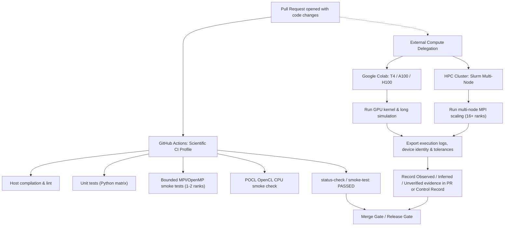

# Scientific CI profiles, evidence boundaries, and external compute delegation

This guide details the **Scientific CI Profiles** (`python-scientific` / `scientific-python` / `python` and `cmake-mpi` / `cpp-hpc-mpi` / `cmake`), generated pull-request and default-branch checks, matrix sizing strategies, compiler and package caching mechanisms, Git LFS choices, **Stable Status Check** reporting, and evidence demarcation standards provided by `sciflow-cicd`. It also outlines the operational protocol for delegating long-running simulations, distributed scaling experiments, and hardware accelerator benchmarks to external compute environments such as Google Colab or high-performance computing (HPC) clusters.

## Motivation and architectural challenges

Scientific and numerical software repositories have fundamentally different testing requirements compared to general-purpose web services:

- **Heterogeneous toolchains**: Projects combine compiled kernels (C, C++, Fortran, OpenCL, CUDA), message-passing interfaces (OpenMPI, MPICH), shared-memory OpenMP (`OMP_NUM_THREADS`), and high-level analytical environments (NumPy, SciPy, PyTorch, JAX).
- **Execution cost mismatch**: Full numerical simulations, molecular dynamics trajectories, parameter sweeps, and machine learning training cycles require hours or days on dedicated hardware, whereas continuous integration on pull requests requires low-latency feedback (typically under 5–10 minutes).
- **Virtual execution environments**: Standard GitHub Actions hosted runners (`ubuntu-24.04`) are ephemeral CPU-only virtual machines (`2–4` vCPUs, 7–16 GB RAM) with shared memory and zero physical hardware accelerators (GPUs, TPUs) or high-speed cluster interconnects (InfiniBand, Slingshot).
- **Risk of misattribution**: Tests passing on virtual CPU runners (such as CPU-emulated OpenCL via POCL or single-node oversubscribed MPI rank checks) risk being mistakenly interpreted as verification of physical GPU kernel correctness, multi-node cluster scalability, or scientific/numerical reproducibility.

To resolve these tensions, `sciflow-cicd` provides specialized, versioned CI workflow templates (`profile-ci` version 1) configured through [Interactive Setup](workflows.md#versioned-workflow-installation) or declarative [Policy](policy-reference.md) documents. Workflows are staged through an owner-reviewed [Setup Pull Request](workflows.md#versioned-workflow-installation) (`codex/workflows-*`), ensuring no unreviewed workflow files reach the default branch.

---

## Profile comparison, generated checks, and required-check summary

Maintainers choose between the scientific Python profile, the C++/CMake/MPI profile, or standard pull-request CI depending on the repository's primary stack. The table below summarizes the generated pull-request checks, default-branch push checks, matrix dimensions, caching, Git LFS options, and terminal **Stable Status Check** anchors aligned with [the maintainer reference](maintainer-reference.md#1-scientific-ci-profiles-and-hardware-evidence-boundaries):

| Profile Identifier (`profile` / `README.md` name) | Target Workflow File | Generated Pull-Request Checks (`pull_request`) | Default-Branch Checks (`push` to `main`) | Optional Matrix Dimensions | Caching & Git LFS Options | Terminal Required Check (`status_check_name`) |
| --- | --- | --- | --- | --- | --- | --- |
| **`python-scientific`** (`profile: "python"` or `"scientific-python"`, template `profile-ci` v1) | `.github/workflows/ci.yml` (or `python-ci.yml` when staged alongside `cmake-mpi`) | Optional `Detect Changes` (`detect-changes`), lint steps / `lint` and matrix unit tests (`unit-tests` / `Python CI (3.10)`, `Python CI (3.11)`, `Python CI (3.12)`), plus terminal gate `status-check` (`if: always()`). | Runs PR checks; heavier default-branch jobs (`full-test-suite`, `coverage` gated by `if: github.event_name == 'push' && github.ref == 'refs/heads/main'`) run only on `main` pushes and are excluded from PR required checks. | `versions` / `python_versions`: `["3.10", "3.11", "3.12"]` (default), `["3.11", "3.12"]` (minimal), or `["3.12"]` (single version). | `cache: true/false` (`cache: "pip"` on `actions/setup-python`, or `enable-cache: true` on `astral-sh/setup-uv`); `lfs: true/false` (`lfs: true` on `actions/checkout`). | `status-check` |
| **`cmake-mpi` / `cpp-hpc-mpi`** (`profile: "cmake-mpi"` or `"cmake"`, template `profile-ci` v1) | `.github/workflows/ci.yml` (or `cmake-ci.yml` when staged alongside `python-scientific`) | Optional `Detect Changes` (`detect-changes`), smoke build & MPI/OpenMP test matrix (`smoke-build-test` / `CMake MPI CI (1-rank)`, `CMake MPI CI (2-rank)`), plus terminal gate `status-check` or `smoke-test` (`if: always()`). | Runs PR smoke checks; heavier default-branch validation (`extended-mpi-validation` with 4 oversubscribed MPI ranks on `push` to `main`) never blocks pull requests. | `ranks` / `mpi_ranks`: `[1, 2]` (default `2` ranks for multi-rank smoke); `omp_threads`: default `2` (`OMP_NUM_THREADS=2`); `compilers`: `["gcc"]` or `["gcc", "clang"]`. | `ccache: true/false` (`CCACHE_DIR`, or `actions/cache` with `CCACHE_MAXSIZE=500M`); `lfs: true/false` (`lfs: true` on `actions/checkout`); `opencl: true/false` (CPU POCL runtime). | `status-check` (default in `profile-ci`) or `smoke-test` (via `status_check_name: "smoke-test"`) |
| **Standard PR CI** (`template: "pr-ci"` / `ci` v1) | `.github/workflows/ci.yml` | Single unmatrixed job `ci` (`PR CI` / `test`) running caller-supplied `commands`. | Triggered on `pull_request` (and optional `workflow_dispatch`) only. | None (single runner). | None by default. | `ci` / `test` |

---

## Scientific Python CI profile (`python-scientific` / `python`)

The scientific Python profile (`profile: "python"` or `"scientific-python"` in `scripts/install_github_workflows.py`, referred to as `python-scientific` in [`README.md`](../README.md)) provides automated dependency management, multi-version matrix execution, package caching, Git LFS asset retrieval, and selective path filtering for scientific Python repositories.

### Configuration options

The profile accepts the following settings within a Policy `workflows` stage (the deprecated `ci-profile` stage has been removed in favor of the unified `workflows` schema):

| Option | Type | Default | Description |
| --- | --- | --- | --- |
| `runs_on` | str or list of str | `"self-hosted"` | Runner labels for the CI workload job (`"self-hosted"`, custom label list, or hosted `"ubuntu-24.04"`). |
| `versions` (or `python_versions`) | list of str | `["3.10", "3.11", "3.12"]` (interactive/autodetect) or `["3.11", "3.12"]` | Supported Python versions (format `X.Y`, such as `["3.10", "3.11", "3.12"]`, `["3.11", "3.12"]`, or `["3.12"]`). Duplicate versions are rejected. |
| `python_setup_mode` | str (`"setup-python"`, `"uv"`, or `"system"`) | `"setup-python"` | Python runtime setup mode. In `"system"` mode, the job utilizes pre-installed system Python without downloading or installing via `actions/setup-python`. |
| `package_manager` | str (`"pip"`, `"uv"`, or `"none"`) | `"pip"` | Dependency manager and caching engine. |
| `cache` | bool | `false` when omitted | Enables native dependency caching (`cache: "pip"` on `actions/setup-python` for `pip`; `enable-cache: true` on `astral-sh/setup-uv` for `uv`). Explicit `true`/`false` is honored; Headless Mode injects an explicit value based on detected dependency manifests. |
| `install_commands` | list of str (optional) | `None` | Optional explicit dependency installation commands (e.g. `["pip install -e ."]`). |
| `commands` (or `test_commands`) | list of str | `["python3 -m unittest discover -s tests"]` | Nonempty unit test commands executed in each matrix leg (`unit-tests` / `Python CI (${{ matrix.python-version }})`). |
| `lint_commands` | list of str (optional) | `None` | Optional linting or static analysis commands (e.g. `ruff check .`, `flake8 .`) executed before unit tests (`lint`). |
| `post_merge_commands` | list of str (optional) | `None` | Push-only post-merge commands executed on `push` to default branch in an isolated `post-merge` job, excluded from the pull-request `status-check`. |
| `lfs` | bool | `false` | Toggles `lfs: true` on `actions/checkout` for retrieving Git LFS reference test fixtures. |
| `paths` | list of str (optional) | `None` | Path patterns that trigger CI on pull requests (e.g. `["**/*.py", "pyproject.toml"]`). |
| `status_check_name` | str | `"status-check"` | Name of the terminal unmatrixed **Stable Status Check** anchor job. |

> **Runner Isolation & Fork Guard:** Configurable workload jobs default to `runs_on: self-hosted`. When targeting `self-hosted` runners on public repositories, `sciflow-cicd` injects a **Fork Execution Guard** (`if: github.event.pull_request.head.repo.full_name == github.repository`) to prevent untrusted fork pull requests from executing on self-hosted infrastructure. Auxiliary control jobs (`detect-changes` and `status-check`) remain pinned to `ubuntu-24.04` (hosted runner VM isolation) so fork PRs never execute control logic on self-hosted machines and status checks never deadlock. Legacy aliases (`options`, `pip_cache`, `git_lfs`) have been removed in favor of canonical keys (`cache`, `lfs`).

### Pull-request vs default-branch check separation

Scientific Python repositories often distinguish fast pull-request feedback from heavier post-merge validation:
- **Pull-request checks (`pull_request`)**: Execute fast static analysis (`lint` / `lint_commands`) and unit test suites (`unit-tests` across `python-version` matrix legs `Python CI (3.10)`, `Python CI (3.11)`, `Python CI (3.12)`), aggregated behind the single required terminal check `status-check`.
- **Default-branch checks (`push` to `main`)**: Heavier regression runs (`full-test-suite` and `coverage`, guarded by `if: github.event_name == 'push' && github.ref == 'refs/heads/main'`) run only after changes land on `main` (or via explicit `commands` / external delegation). Because push-only jobs are skipped on `pull_request` events, they must never be listed in `needs:` of `status-check` or configured as required pull-request status checks.

### Matrix sizing and version selection

Continuous integration on pull requests must balance platform coverage against runner queue saturation:

- **Supported matrix presets**:
  - **Default matrix**: `["3.10", "3.11", "3.12"]` (`DEFAULT_PYTHON_VERSIONS` in `scripts/install_github_workflows.py`).
  - **Minimal matrix**: `["3.11", "3.12"]` for lower runner consumption.
  - **Single version**: `["3.12"]` (or the version pinned in `.python-version`) for rapid solo-maintainer smoke checks.
- **Fail-fast behavior**: The generated matrix configures `strategy.fail-fast: false`. If tests fail on Python 3.11, the Python 3.12 runner continues to completion, providing maintainers with complete cross-version diagnostics in a single run.
- **Path filtering**: When `paths` are specified (e.g. `["**/*.py", "pyproject.toml", "requirements*.txt"]`), a lightweight `detect-changes` job checks whether relevant code changed against `origin/${GITHUB_BASE_REF}`. The inline change detection script expands globstar patterns: `**/*.py` matches root-level files (`main.py`) as well as nested paths (`src/sub/mod.py`); `tests/**/*.py` matches direct children (`tests/test_a.py`) and deeper subdirectories (`tests/unit/test_b.py`); trailing `/**` and `/*` directory prefixes are fully supported. Non-code changes (such as Markdown documentation updates) skip the heavy CI matrix while `status-check` still executes and passes.

### Dependency caching: `pip` (`cache`) and `uv`

Scientific Python dependencies (NumPy, SciPy, Pandas, PyTorch) frequently involve large pre-compiled binary wheels that consume substantial network bandwidth and installation time:

- **`pip` caching (`cache: true`)**: Configures `actions/setup-python` with `cache: "pip"`, storing and restoring wheels cached in `~/.cache/pip`. **Important prerequisite**: `actions/setup-python` fails with `No file ... matched to [**/requirements.txt or **/pyproject.toml]` if the repository has no dependency manifest. For pure standard-library projects or repositories without `requirements.txt`/`pyproject.toml`, set `"cache": false` in the `python` policy options and install test runners explicitly in `commands` (for example `["pip install pytest pyyaml", "pytest -v"]`), or commit a root `requirements.txt`. Setting `cache: false` also serves clean-room dependency resolution checks.
- **`uv` caching**: When `package_manager: "uv"` is selected, the workflow installs `astral-sh/setup-uv` pinned by full 40-character commit SHA and activates `enable-cache: true` when `cache: true`.
- **Cache invalidation safety**: Cache keys are automatically tied to runner OS and lockfile/requirements hashes. When dependencies update, caches refresh automatically without stale artifact pollution.

### Action pin verification and supply chain security

All Actions incorporated into `profile-ci` templates are pinned to immutable 40-character commit SHAs:
- `actions/checkout` (default `11bd71901bbe5b1630ceea73d27597364c9af683`)
- `actions/setup-python` (default `ece7cb06caefa5fff74198d8649806c4678c61a1`)
- `astral-sh/setup-uv` (default `d4b2f3b6ecc6e67c4457f6d3e41ec42d3d0fcb86`)

During workflow staging via `install()` or `install_selected()`, every pinned commit SHA is verified against the upstream GitHub Commit API (`/repos/{owner}/{repo}/git/commits/{sha}`) before staging bytes. Unverified or mutated SHAs immediately abort staging. Legacy non-profile PR CI (`pr-ci`) maintains its strict single-job contract (`ci:`) without unsolicited concurrency or terminal status-check injections.

### Local workspace detection in Interactive Setup

When running `sciflow-cicd` interactively within a workspace:
- **Local indicator files**: `detect_python_project(root_dir=...)` inspects local indicator files (`pyproject.toml`, `requirements.txt`, `setup.py`, `.python-version`, `environment.yml`, etc.) even when GitHub API repository language statistics are unpopulated.
- **Git LFS auto-discovery**: `detect_git_lfs(root_dir=...)` inspects local `.gitattributes` for `filter=lfs`, preselecting Git LFS checkout automatically.
- **Python version discovery**: `detect_python_versions(root_dir=...)` checks local `.python-version` files to populate default matrix versions, falling back to `["3.10", "3.11", "3.12"]`.

### Git LFS choices (`lfs: true/false`) and runner quota trade-offs

Scientific algorithms often require binary reference fixtures—small simulation meshes, baseline convergence snapshots, or test tensors:

- **Enabling Git LFS (`lfs: true`)**: Configures `with: lfs: true` on `actions/checkout`, pulling tracked LFS objects during checkout before tests run.
- **Leaving Git LFS disabled (`lfs: false`, default)**: Skips LFS smudge downloads so repositories that generate synthetic test fixtures in code avoid unnecessary network transfers.
- **Quota and bandwidth implications on GitHub-hosted runners**: Every matrix leg (`Python CI (3.10)`, `Python CI (3.11)`, `Python CI (3.12)` or `CMake MPI CI (1-rank)`, `CMake MPI CI (2-rank)`) checks out the repository in a fresh ephemeral VM and consumes GitHub Git LFS bandwidth quota on every pull request push. Keep CI LFS fixtures small (under 50 MB total); never pull multi-gigabyte simulation datasets in pull-request CI.

---

## CMake, C++, OpenMP, and MPI CI profile (`cmake-mpi` / `cpp-hpc-mpi`)

The `cmake-mpi` profile (template `profile-ci`, also referred to as `cpp-hpc-mpi` in architectural overviews and [`README.md`](../README.md)) provides specialized support for compiled scientific codes relying on CMake (or `make`), MPI (OpenMPI), OpenMP (`OMP_NUM_THREADS`), compiler caching (`ccache`), and optional OpenCL CPU kernel compilation (`POCL`).

### Configuration options

The profile accepts the following settings within a Policy `workflows` stage (the deprecated `ci-profile` stage has been removed in favor of the unified `workflows` schema):

| Option | Type | Default | Description |
| --- | --- | --- | --- |
| `runs_on` | str or list of str | `"self-hosted"` | Runner labels for the CMake/MPI smoke job (`"self-hosted"`, custom label list, or hosted `"ubuntu-24.04"`). |
| `ranks` (or `mpi_ranks`) | list of int | `[1, 2]` (default 2-rank multi-rank smoke) | Positive integer MPI rank counts executed in the pull-request smoke matrix (`CMake MPI CI (${{ matrix.ranks }}-rank)` / `smoke-build-test`). |
| `compilers` | list of str (optional) | `None` | Matrix of compilers to test: `["gcc"]` or `["gcc", "clang"]`. |
| `omp_threads` | int or list of int | `2` | OpenMP thread count (`OMP_NUM_THREADS`). Can be an integer or a list of integers to matrix. |
| `install_system_deps` | bool | `false` on `self-hosted`, `true` on `ubuntu-24.04` | Whether to run `sudo apt-get` for `runner_dependencies`. Defaults to `false` on self-hosted runners to prevent failure in unprivileged environments. |
| `build_commands` | list of str | `["cmake -B build -S .", "cmake --build build"]` | Build commands executed before testing (supports compiler flags or `compilers` matrix selections such as `["gcc"]` or `["gcc", "clang"]`). |
| `test_commands` | list of str | `["ctest --test-dir build --output-on-failure"]` | Smoke test commands executed under each matrix rank count with `MPI_RANKS: "${{ matrix.ranks }}"` (e.g. `mpirun --oversubscribe -np 2` and `OMP_NUM_THREADS=2` for `omp_threads` default `2`). |
| `runner_dependencies` (or `apt_packages`) | list of str | `["libopenmpi-dev", "openmpi-bin"]` | System `apt` packages installed on the runner (add `clang` when testing `["gcc", "clang"]`). |
| `ccache` | bool | `true` | Installs and configures `ccache` compiler caching (`CCACHE_DIR=${{ github.workspace }}/.ccache`, compatible with `actions/cache` and bounded cache sizes such as `CCACHE_MAXSIZE=500M`). |
| `cache` | bool (optional) | `false` | Whether to persist ccache artifacts using `actions/cache` pinned commit SHA (`cache_sha`). |
| `cache_sha` | str (optional) | `13aacd865c2ea734d23908f43a1f0d9bf8ec9456` | Pinned 40-character commit SHA for `actions/cache` (default v4.2.0). |
| `extended_ranks` | list of int (optional) | `None` | MPI rank counts for heavier post-merge validation (`extended-mpi-validation`), executed strictly on `push` to default branch and excluded from `status-check`. |
| `post_merge_commands` | list of str (optional) | `None` | Push-only post-merge validation commands executed on default branch and excluded from `status-check`. |
| `lfs` | bool | `false` | Toggles `lfs: true` on `actions/checkout` for binary mesh or reference array fixtures. |
| `opencl` | bool | `false` | Provisions POCL OpenCL CPU emulation packages (`pocl-opencl-icd`, `ocl-icd-opencl-dev`, `opencl-headers`, `clinfo`) and runs `clinfo`. |
| `manual_build` | bool | `false` | Sets default build command to `make -j` when CMake is not used. |
| `paths` | list of str (optional) | `None` | Path patterns triggering CI (e.g. `["CMakeLists.txt", "src/**", "include/**"]`). |
| `status_check_name` | str | `"status-check"` (or `"smoke-test"`) | Name of the terminal **Stable Status Check** anchor job (`status-check` by default; configurable to `smoke-test`). |

> **Runner Isolation & Fork Guard:** Configurable workload jobs default to `runs_on: self-hosted`. When targeting `self-hosted` runners on public repositories, `sciflow-cicd` injects a **Fork Execution Guard** (`if: github.event.pull_request.head.repo.full_name == github.repository`) to protect self-hosted nodes. Auxiliary control jobs (`detect-changes` and `status-check`) remain pinned to `ubuntu-24.04` (hosted runner VM isolation) so untrusted PRs never execute control logic on self-hosted machines and status checks never deadlock. Workflows include explicit `# EVIDENCE DEMARCATION:` header comments and step notices demarcating self-hosted user-provisioned infrastructure from virtual CPU-only execution.

### Bounded MPI rank counts, oversubscription (`mpirun --oversubscribe -np 2`), and OpenMP threads

GitHub Actions hosted `ubuntu-24.04` runners execute on virtual machines with `2–4` vCPUs and shared memory. Running distributed-memory and hybrid MPI + OpenMP tests on virtual runners requires strict boundary awareness:

- **Pull-request smoke rank sizing (`ranks: [1, 2]` / `mpi_ranks: 2`, `omp_threads: 2`)**: The default matrix `ranks: [1, 2]` tests 1-rank serial execution (`CMake MPI CI (1-rank)`) and 2-rank distributed message passing (`CMake MPI CI (2-rank)`), exposing `MPI_RANKS="${{ matrix.ranks }}"` to each test step. When invoking `mpirun` directly or inside CTest on a 2-vCPU runner, pass `--oversubscribe` (for example `OMP_NUM_THREADS=2 mpirun --oversubscribe -np 2 ./build/solver_smoke`) so OpenMPI does not abort when rank × thread slots (`mpi_ranks: 2` × `omp_threads: 2`) exceed physical vCPU cores.
- **Default-branch extended MPI validation (`extended-mpi-validation`)**: When a repository also runs a heavier 4-rank oversubscribed check (`mpirun --oversubscribe -np 4` in an `extended-mpi-validation` job on `push` to `main`), keep it restricted to default-branch pushes so thread oversubscription and scheduling jitter do not slow down or destabilize pull requests.
- **Compiler matrix choices (`compilers: ["gcc"]` vs `["gcc", "clang"]`)**: Small scientific repositories should default to `["gcc"]` on pull requests for fast turnaround, adding `["gcc", "clang"]` when checking standard-library or OpenMP pragma portability across GCC and Clang.
- **Fail-fast disabled**: `strategy.fail-fast: false` ensures that both 1-rank and 2-rank smoke test results are observed independently.

### Compiler caching with `ccache`

Recompiling C++ or Fortran templates across every pull request commit wastes runner minutes:

- When `ccache: true` is enabled, the workflow installs `ccache`, prepends `/usr/lib/ccache` to `$GITHUB_PATH`, and sets `CCACHE_DIR=${{ github.workspace }}/.ccache` in `$GITHUB_ENV`.
- When persisted across runs with `actions/cache`, bound the cache size (for example `CCACHE_MAXSIZE=500M`) so object caches do not evict dependency caches under GitHub's 10 GB repository cache limit.

### OpenCL CPU runtime emulation via POCL

Many scientific acceleration kernels are authored in OpenCL or portable frameworks targeting GPUs. When physical GPUs are unavailable in hosted CI, verifying that kernels compile and pass host functional logic tests is essential:

- When `opencl: true` is configured, the workflow provisions:
  - `pocl-opencl-icd`: Portable Computing Language (POCL) CPU OpenCL implementation.
  - `ocl-icd-opencl-dev`: OpenCL Installable Client Driver development files.
  - `opencl-headers`: Standard OpenCL C headers.
  - `clinfo`: Utility to inspect and verify available OpenCL platforms and devices.
- The workflow executes `clinfo` to verify platform visibility before compiling and testing kernels on the CPU fallback runtime.

---

## Stable status check anchor pattern

A critical failure mode in matrixed, path-filtered, or push-split CI workflows is the **skipped-workflow pending-check deadlock** (`Expected — Waiting for status to be reported`):

1. **Path-filter skips**: If a pull request modifies only documentation (`README.md`, `docs/**`) and `detect-changes` sets `run_ci=false`, the `ci` / `unit-tests` / `smoke-build-test` job is skipped. If a branch ruleset required that matrix job directly, GitHub waits forever for a check run that never executes.
2. **Skipped default-branch jobs**: Jobs gated on `if: github.event_name == 'push' && github.ref == 'refs/heads/main'` (such as `full-test-suite`, `coverage`, or `extended-mpi-validation`) are always `skipped` on `pull_request` events. Requiring them in a branch ruleset permanently deadlocks every pull request.
3. **Matrix dimension changes**: If a branch ruleset requires `Python CI (3.10)` or `CMake MPI CI (4-rank)` and the maintainer later updates the matrix to `["3.11", "3.12"]` or `[1, 2]`, the old check context disappears and blocks all merges until the ruleset is manually edited.

### The terminal anchor pattern (`status-check` and `smoke-test`)

To eliminate hanging checks, all `profile-ci` workflows generate a stable, unmatrixed terminal anchor job (`status-check` by default, or `smoke-test` when `status_check_name: "smoke-test"` is configured) with `if: always()`:

```yaml
  status-check:
    name: "status-check"
    needs: [detect-changes, ci]
    if: always()
    runs-on: ubuntu-24.04
    permissions:
      contents: read
    steps:
      - name: "Evaluate status check"
        env:
          NEEDS_CONTEXT: ${{ toJson(needs) }}
        run: |
          python3 -c '
          import json, sys, os
          needs = json.loads(os.environ.get("NEEDS_CONTEXT", "{}"))
          failed = [name for name, job in needs.items() if job.get("result") in ("failure", "cancelled")]
          skipped = [name for name, job in needs.items() if job.get("result") == "skipped"]
          success = [name for name, job in needs.items() if job.get("result") == "success"]
          print(f"Status check results - success: {success}, skipped: {skipped}, failed: {failed}")
          if failed:
              sys.exit(f"Status check failed: {failed}")
          print("Status check passed.")
          '
```

### Operational characteristics and automated discrepancy enforcement

- **`if: always()` execution**: The terminal anchor job (`status-check` or `smoke-test`) runs on every pull request regardless of whether upstream jobs succeeded, failed, or were skipped.
- **Dynamic `needs` evaluation (`evaluate_status_check`)**: It inspects `NEEDS_CONTEXT` (`${{ toJson(needs) }}`). If any upstream PR job reported `failure` or `cancelled`, the anchor exits nonzero (`Status check failed: ...`). If upstream PR jobs were skipped by `detect-changes`, `failed` is empty and the anchor exits `0` (`Status check passed.`).
- **Automated ruleset alignment (`inspect_remote_workflow_status_check` and `reconcile_gates`)**:
  - `scripts/install_github_workflows.py:extract_profile_status_check` and `inspect_remote_workflow_status_check` parse the workflow's `# sciflow-cicd workflow-template=profile-ci version=1` marker and `status-check:` job `name:` field from the repository or staged policy.
  - During Interactive Setup (`scripts/interactive_workflows_rulesets.py:prompt_rulesets_stage`), `sciflow-cicd` automatically proposes the profile's declared check name (`status-check` or `smoke-test`) for branch rulesets.
  - During Dry-Run (`scripts/setup_github_repo.py:_detect_profile_check_discrepancy`) and apply (`scripts/configure_github_repo.py:reconcile_gates`), `sciflow-cicd` rejects any mismatched check name (such as a raw matrix leg `Python CI (3.11)` or `CMake MPI CI (1-rank)`) with `Discrepancy detected: configured ruleset check '...' does not match profile workflow declared check '...'`. See [proportional security and controls](proportional-security-and-controls.md).

---

## Evidence standards and demarcation boundaries

Scientific claims must adhere to the `Observed / Inferred / Unverified` evidence gate. **CPU-only pull-request smoke checks do not claim, prove, or verify real GPU execution, full multi-node HPC cluster scaling, or numerical/scientific reproducibility.**

The full live disposable-repository release audit remains out of scope for this guide and is tracked separately; no live release-audit evidence is asserted here.

### Demarcation categories

When recording verification results in pull requests, issues, or documentation, maintainers and agents must separate claims into three distinct categories:

1. **Observed**: Concrete, directly measured results produced by a documented command on a specific runner, including exact command, input, platform (`ubuntu-24.04` CPU runner vs physical GPU/cluster node), rank/thread count (`ranks`, `OMP_NUM_THREADS`), and exit status.
2. **Inferred**: Logical deductions regarding algorithm or control-flow behavior within the boundaries of the tested environment, with uncertainty stated explicitly.
3. **Unverified**: Missing checks, unexecuted hardware paths (physical NVIDIA/AMD/Intel GPUs, multi-node InfiniBand/Slingshot fabrics), and scientific/numerical reproducibility claims that were not executed on the target hardware.

| Verification Claim | Required Evidence | Demarcation Boundary | If Missing |
| --- | --- | --- | --- |
| **Host source compilation** | Successful `cmake --build`, `mpicxx`, or Python syntax/import check on `ubuntu-24.04` | **Observed**: Host CPU compilation succeeds | State compilation is unverified |
| **Host multi-rank MPI / OpenMP smoke test** | Successful test on virtual runner with 1 or 2 MPI ranks (`mpirun --oversubscribe -np 2`, `OMP_NUM_THREADS=2`) | **Observed**: Shared-memory virtual CPU multi-rank execution and collective ordering. **Unverified**: Multi-node physical cluster scaling or interconnect behavior | State multi-node HPC scaling is unverified |
| **OpenCL kernel CPU fallback** | Kernel execution via `pocl-opencl-icd` CPU OpenCL runtime | **Observed**: Software execution on CPU fallback (`POCL`). **Unverified**: Physical GPU execution | State device behavior is unverified |
| **Real GPU / Accelerator execution** | Execution on physical hardware (e.g. NVIDIA CUDA, AMD ROCm, Intel SYCL) with device identity (`nvidia-smi` / `rocm-smi`) and output check | **Observed on external platform only**. GitHub Actions hosted CPU runners cannot establish this | State real GPU kernel correctness is unverified |
| **Numerical correctness & scientific reproducibility** | Measured output compared against a recorded same-input reference with explicit source and tolerance (`atol`, `rtol`) across target hardware | **Observed for the specific test fixture on host CPU only**. Passing CI smoke checks does not claim full scientific or numerical reproducibility | State numerical reproducibility is unverified |
| **Performance speedup** | Repeated, unprofiled wall-clock timings on identical dedicated hardware (baseline vs candidate) with warm-up and variance | **Unverified on noisy multi-tenant GitHub-hosted virtual runners** | State speedup is unverified |

### Automated workflow notice annotations

To guarantee that evidence boundaries are transparent to reviewers, the `cmake-mpi` workflow injects explicit header comments (`# EVIDENCE DEMARCATION:`) and GitHub Actions workflow notice annotations during execution:

```bash
echo "::notice title=Device Boundary Demarcation::GitHub Actions executes on hosted CPU runner. Device/GPU kernels tested under CPU fallbacks or OpenCL POCL do not constitute real GPU validation."
echo "Observed: Host compilation and CPU execution on ubuntu-24.04 with ${{ matrix.ranks }} MPI rank(s)."
echo "Unverified: Real GPU/accelerator hardware execution and multi-node interconnect scaling."
```

When `opencl: true` is enabled, an additional demarcation notice is logged:

```bash
echo "::notice title=OpenCL Device Boundary::OpenCL tests execute via CPU runtime (POCL). Real GPU device kernel verification is UNVERIFIED."
```

These annotations appear directly in the GitHub pull request UI, preventing contributors from claiming that green CPU smoke checks validate real GPU hardware, multi-node HPC scaling, or scientific reproducibility.

---

## Delegating heavy scientific simulations: Google Colab and HPC handoff

GitHub Actions hosted runners have strict operational boundaries: `2–4` vCPUs, 7–16 GB RAM, a 6-hour execution timeout, and zero physical GPU accelerators. Long-running simulations, training runs, large parameter sweeps, and accelerator benchmarks must be delegated to external platforms.



### Delegation workflow

Maintainers should establish a structured handoff protocol for offloading heavy workloads:

#### 1. Decouple fast smoke tests from heavy simulations
Structure test suites so that fast CPU unit/smoke checks run in pull-request CI, while heavy or hardware-dependent workloads are opt-in:
- In pytest: use custom markers (`@pytest.mark.slow`, `@pytest.mark.gpu`). In PR CI, invoke:
  ```bash
  pytest -v -m "not slow and not gpu"
  ```
- In CMake/CTest: tag test targets with labels (`smoke`, `benchmark`, `distributed`):
  ```bash
  ctest --test-dir build -L smoke --output-on-failure
  ```

#### 2. Provide self-contained external runners (Google Colab or Slurm)
Maintain reproducible runner scripts or Jupyter notebooks (e.g. under `benchmarks/` or `notebooks/`):
- Ensure the notebook or batch script checks out the exact pull-request commit SHA, installs accelerator dependencies (e.g. PyTorch/JAX CUDA wheels or cluster MPI modules), and records `git rev-parse HEAD`.

#### 3. Enforce explicit numerical references and tolerances
Never rely on subjective output or undefined floating-point equality:
- Compare measured simulation output against recorded reference data using explicit tolerances:
  ```python
  import numpy as np
  np.testing.assert_allclose(candidate_output, reference_output, rtol=1e-5, atol=1e-7)
  ```
- State the reference source, platform, rank/thread counts, and tolerance explicitly in the pull request description.

#### 4. Capture and export execution metadata
When running on Google Colab or an HPC cluster, record:
- **Device identity**: Output of `nvidia-smi` or `rocm-smi` (device model, driver version, CUDA/ROCm version).
- **Host topology**: CPU model, physical core count, node count, interconnect, and memory allocation.
- **Timing data**: Warm-up cycles, raw unprofiled execution samples, median wall-clock time, and variation.
- **Evidence boundary**: Explicitly mark paths that ran on external hardware as **Observed** (with platform details) and any unexecuted hardware/scale targets as **Unverified**.

#### 5. Feed evidence back to PRs and Release Control Records
- **Pull request reviews**: Include the external execution log and metadata in the pull request body or comments before merging.
- **Release qualification**: For formal [Release Candidates](release-evidence.md), record external verification evidence in the base-branch [Control Record](release-evidence.md) (`docs/release-control.md` and `docs/release-control.json`) to satisfy the fail-closed **Release Gate**.

---

## Policy configuration examples

### Policy version 2: Scientific Python CI (`python-scientific` / `python`)

```json
{
  "version": 2,
  "repository": "OWNER/REPO",
  "stages": [
    {
      "name": "workflows",
      "workflows": [
        {
          "template": "profile-ci",
          "template_version": 1,
          "profile": "python",
          "filename": "ci.yml",
          "triggers": ["pull_request"],
          "checkout_sha": "11bd71901bbe5b1630ceea73d27597364c9af683",
          "runs_on": "self-hosted",
          "status_check_name": "status-check",
          "python": {
            "versions": ["3.10", "3.11", "3.12"],
            "package_manager": "pip",
            "commands": ["pytest -v -m 'not slow and not gpu'"],
            "lint_commands": ["ruff check ."],
            "lfs": false,
            "cache": true
          },
          "paths": ["**/*.py", "pyproject.toml", "requirements*.txt"]
        }
      ]
    }
  ]
}
```

### Policy version 2: CMake and MPI CI (`cmake-mpi` / `cpp-hpc-mpi`)

```json
{
  "version": 2,
  "repository": "OWNER/REPO",
  "stages": [
    {
      "name": "workflows",
      "workflows": [
        {
          "template": "profile-ci",
          "template_version": 1,
          "profile": "cmake-mpi",
          "filename": "ci.yml",
          "triggers": ["pull_request"],
          "checkout_sha": "11bd71901bbe5b1630ceea73d27597364c9af683",
          "runs_on": "self-hosted",
          "status_check_name": "smoke-test",
          "cmake_mpi": {
            "ranks": [1, 2],
            "build_commands": ["cmake -B build -S .", "cmake --build build"],
            "test_commands": [
              "ctest --test-dir build -L smoke --output-on-failure",
              "OMP_NUM_THREADS=2 mpirun --oversubscribe -np 2 ./build/mpi_smoke"
            ],
            "runner_dependencies": ["libopenmpi-dev", "openmpi-bin"],
            "install_system_deps": false,
            "ccache": true,
            "opencl": false,
            "manual_build": false
          },
          "paths": ["CMakeLists.txt", "src/**", "include/**", "tests/**"]
        }
      ]
    }
  ]
}
```

Both configurations can also be generated through **Interactive Setup** (`sciflow-cicd`) or **Headless Mode** (`sciflow-cicd dry-run --policy ...` followed by `sciflow-cicd apply --policy ... --dry-run-result ...`). Changes are calculated via [Dry-Run](policy-reference.md#applying-policies) and staged in a single draft [Setup Pull Request](workflows.md#versioned-workflow-installation) for **owner merge**.

---

## End-to-end live and local disposable validation

Validation of scientific CI profiles covers target repositories (`OWNER/REPO`), **Setup Pull Request** creation, Python matrix and 1-rank/2-rank/4-rank oversubscribed MPI + OpenMP smoke execution, `pip` and `ccache` caching, **Stable Status Check** (`status-check` and `smoke-test`) reporting, post-merge idempotency, and explicitly unverified GPU/HPC paths in `tests/test_p6_183_scientific_ci_guidance.py` and `.github/workflows/ci.yml`.
